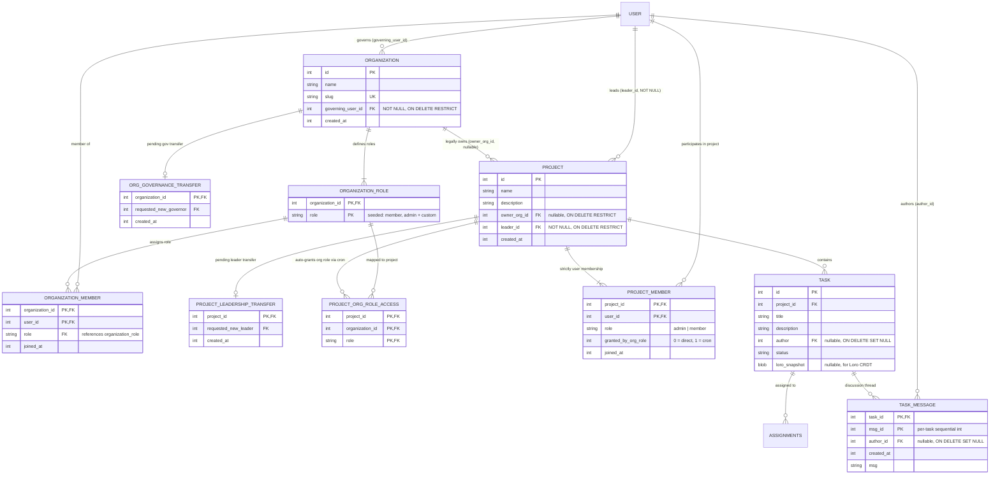

# Architecture & Implementation Plan: Organizations, Projects, Editable Tasks & Discussions

This document outlines the revised architecture, database layout, performance analysis, and phased implementation plan.

---

## 1. Critical Database & Architecture Evaluation

### 1.1 Account Deletion & Data Provenance ("Right to be Forgotten")
- **No `created_by` Columns**: Historical creation provenance has been removed from `organization` and `project` so users are not permanently tied to entities they no longer govern or lead.
- **Preserving Shared Work (`ON DELETE SET NULL`)**:
  - `task.author` and `task_message.author_id` are nullable foreign keys (`INTEGER REFERENCES user(id) ON DELETE SET NULL`).
  - If a user deletes their account, their tasks and discussion comments remain intact and render as `"Deleted User"`.
- **Governance & Leadership Guardrails**:
  - `organization.governing_user_id` and `project.leader_id` use `ON DELETE RESTRICT`. A governor or project leader cannot delete their account while leaving a populated organization or project leaderless; they must either transfer leadership/governance or (once all other members are removed) delete the entity.

### 1.2 Extensible Organization Roles (`organization_role`) & Role-Based Project Provisioning (`project_org_role_access`)
- **Custom Organization Roles (`<organization_id, role>`)**:
  - Every organization has different structure and access needs (e.g. `'devops'`, `'finance'`, `'security'`, `'contractor'`).
  - Instead of hardcoding `CHECK (role IN ('admin', 'member'))`, we define a clustered table `organization_role (organization_id, role) WITHOUT ROWID`.
  - When an organization is created, an `AFTER INSERT ON organization` SQLite trigger automatically seeds `(NEW.id, 'member')` and `(NEW.id, 'admin')` into `organization_role`, and a `BEFORE DELETE` trigger protects those two baseline roles from accidental deletion while the organization exists.
  - Both `organization_members` and `organization_invitation` use a **composite foreign key** referencing `organization_role(organization_id, role) ON UPDATE CASCADE ON DELETE RESTRICT`.
- **Role-Scoped Project Access (`<project_id, organization_id, role>`) + Background Cron Materialization**:
  - Granting an entire organization access to a project is unsafe for large organizations, but granting access to **specific organization roles** via `project_org_role_access (project_id, organization_id, role) WITHOUT ROWID` solves this cleanly.
  - **Performance Win of Asynchronous Materialization**:
    - Rather than joining 4 tables on every single HTTP/WebSocket request, **`project_members (project_id, user_id)` remains the single materialized source of truth** on the read hot-path ($O(\log N)$ single B-tree probe).
    - A periodic background job (`tokio::time::interval` cron on the server) reconciles `project_org_role_access` into `project_members`:
      ```sql
      INSERT OR IGNORE INTO project_members (project_id, user_id, role)
      SELECT pora.project_id, om.user_id, 'member'
      FROM project_org_role_access pora
      INNER JOIN organization_members om
          ON om.organization_id = pora.organization_id
         AND om.role = pora.role;
      ```
    - *Extensibility note on revocation*: By including a lightweight flag `granted_by_org_role INTEGER NOT NULL DEFAULT 0` on `project_members` (set to `1` when inserted by the cron job, `0` when individually invited), the cron job can also cleanly revoke access if a user's org role changes in the future without touching individually invited members!

### 1.3 Dropping Redundant Indexes on Transfer Tables (Little's Law Sizing)
- Consider `organization_governance_transfer` and `project_leadership_transfer` at scale:
  - Even with **100,000 users** and **20,000 organizations** changing governors once a year on average, assuming a transfer offer stays pending for ~2 days before acceptance, Little's Law ($L = \lambda W$) gives an average of $20,000 \times \frac{2}{365} \approx 110$ active rows across the *entire database*.
  - 110 rows of `(int64, int64, int64)` (~2.6 KB total) fit inside a **single 4 KB SQLite B-tree page** cached in RAM.
  - A secondary index on `requested_new_governor` / `requested_new_leader` would double the write cost and allocate extra pages to accelerate a scan that already takes `< 2 µs`. We therefore **omit secondary indexes** on both transfer tables.

### 1.4 Clustered B-Trees (`WITHOUT ROWID`) for Task Discussions & Assignments
- **Task Discussion Threads (`task_message`)**:
  - Schema: `(task_id, msg_id, author_id, created_at, msg)` with `PRIMARY KEY (task_id, msg_id) WITHOUT ROWID`, where `task_id REFERENCES task(id) ON DELETE CASCADE` and `author_id REFERENCES user(id) ON DELETE SET NULL`.
  - All messages for a given `task_id` are stored physically contiguously on the same B-tree leaf pages ordered by `msg_id`. Fetching a task's discussion thread is a single sequential leaf scan.
- **Assignments (`assignments`)**:
  - Changed to `PRIMARY KEY (task_id, assigned_to) WITHOUT ROWID` to fix the existing duplicate-assignment bug and cluster task assignees together.
- **Batching Assignees in `get_all_tasks`**:
  - Replaces the current $N+1$ per-task assignee query loop with a batch query.

### 1.5 Ephemeral Loro Collaboration Service Architecture (Future Phase)
- **Scale-to-Zero Ephemeral Service Design**:
  - Collaborative editing rooms (`LoroDoc`) will run in an **ephemeral collaboration service**:
    1. **Room Spin-Up & Token Handshake**: When a user opens a collaborative view (e.g. `TaskPage`), the main server issues a short-lived room ticket/token and routes the client to the ephemeral worker responsible for `(project_id, task_id)`. The ephemeral service receives a scoped writeback token from the main server.
    2. **Client Heartbeats**:
       - Browser WASM (`dioxus/web`) can send a 4-byte heartbeat frame every 10s over the Loro WebSocket connection or use **WebTransport (HTTP/3 QUIC)** / **WebRTC DataChannels** for UDP-like datagrams (while native desktop clients can use raw UDP or QUIC directly).
    3. **Periodic Writeback & Graceful Shutdown**:
       - While clients are active, the ephemeral service periodically checkpoints the compacted `loro_snapshot BLOB` and materialized `title`/`description` back to the main server.
       - Once all clients have been inactive beyond the grace window, the ephemeral worker performs a final flush to the main server and gracefully shuts down.

---

## 2. Entity-Relationship Diagram



---

## 3. Complete Database Schema DDL (`src/backend/database.rs`)

```sql
-- 1. Users
CREATE TABLE IF NOT EXISTS user (
    id INTEGER PRIMARY KEY,
    name TEXT NOT NULL,
    email TEXT NOT NULL UNIQUE,
    password_hash TEXT NOT NULL DEFAULT ''
);

-- 2. Organizations & Extensible Organization Roles
CREATE TABLE IF NOT EXISTS organization (
    id INTEGER PRIMARY KEY,
    name TEXT NOT NULL,
    slug TEXT NOT NULL UNIQUE,
    governing_user_id INTEGER NOT NULL REFERENCES user(id) ON DELETE RESTRICT,
    created_at INTEGER NOT NULL DEFAULT (unixepoch())
);

-- Per-organization valid roles: <organization_id, role>
-- Automatically seeded with ('member') and ('admin') on organization creation via trigger
CREATE TABLE IF NOT EXISTS organization_role (
    organization_id INTEGER NOT NULL REFERENCES organization(id) ON DELETE CASCADE,
    role TEXT NOT NULL,
    PRIMARY KEY (organization_id, role)
) WITHOUT ROWID;

CREATE TABLE IF NOT EXISTS organization_members (
    organization_id INTEGER NOT NULL REFERENCES organization(id) ON DELETE CASCADE,
    user_id INTEGER NOT NULL REFERENCES user(id) ON DELETE CASCADE,
    role TEXT NOT NULL DEFAULT 'member',
    joined_at INTEGER NOT NULL DEFAULT (unixepoch()),
    PRIMARY KEY (organization_id, user_id),
    FOREIGN KEY (organization_id, role)
        REFERENCES organization_role(organization_id, role)
        ON UPDATE CASCADE ON DELETE RESTRICT
) WITHOUT ROWID;

CREATE INDEX IF NOT EXISTS idx_org_members_user ON organization_members(user_id, organization_id);
CREATE INDEX IF NOT EXISTS idx_org_members_role ON organization_members(organization_id, role);

-- Asynchronous 2-step governance transfer (tiny table: no secondary index needed)
-- Composite FK ensures requested_new_governor is an existing member of the org
CREATE TABLE IF NOT EXISTS organization_governance_transfer (
    organization_id INTEGER PRIMARY KEY REFERENCES organization(id) ON DELETE CASCADE,
    requested_new_governor INTEGER NOT NULL,
    created_at INTEGER NOT NULL DEFAULT (unixepoch()),
    FOREIGN KEY (organization_id, requested_new_governor)
        REFERENCES organization_members(organization_id, user_id) ON DELETE CASCADE
) WITHOUT ROWID;

-- 3. Projects
-- Every project has a human leader (leader_id) and optionally an owning organization (owner_org_id)
CREATE TABLE IF NOT EXISTS project (
    id INTEGER PRIMARY KEY,
    name TEXT NOT NULL,
    description TEXT NOT NULL DEFAULT '',
    owner_org_id INTEGER REFERENCES organization(id) ON DELETE RESTRICT,
    leader_id INTEGER NOT NULL REFERENCES user(id) ON DELETE RESTRICT,
    created_at INTEGER NOT NULL DEFAULT (unixepoch())
);

CREATE INDEX IF NOT EXISTS idx_project_owner_org ON project(owner_org_id) WHERE owner_org_id IS NOT NULL;
CREATE INDEX IF NOT EXISTS idx_project_leader ON project(leader_id);

-- Strictly user-level project membership (clustered B-tree, single source of truth for access)
CREATE TABLE IF NOT EXISTS project_members (
    project_id INTEGER NOT NULL REFERENCES project(id) ON DELETE CASCADE,
    user_id INTEGER NOT NULL REFERENCES user(id) ON DELETE CASCADE,
    role TEXT NOT NULL DEFAULT 'member' CHECK (role IN ('admin', 'member')),
    granted_by_org_role INTEGER NOT NULL DEFAULT 0,
    joined_at INTEGER NOT NULL DEFAULT (unixepoch()),
    PRIMARY KEY (project_id, user_id)
) WITHOUT ROWID;

CREATE INDEX IF NOT EXISTS idx_proj_members_user ON project_members(user_id, project_id);

-- Role-based project access policy: <project_id, organization_id, role>
-- Tells the background cron job to grant project membership to org members holding `role`
CREATE TABLE IF NOT EXISTS project_org_role_access (
    project_id INTEGER NOT NULL REFERENCES project(id) ON DELETE CASCADE,
    organization_id INTEGER NOT NULL,
    role TEXT NOT NULL,
    PRIMARY KEY (project_id, organization_id, role),
    FOREIGN KEY (organization_id, role)
        REFERENCES organization_role(organization_id, role)
        ON UPDATE CASCADE ON DELETE CASCADE
) WITHOUT ROWID;

-- Asynchronous 2-step project leadership transfer (tiny table: no secondary index needed)
-- Composite FK ensures requested_new_leader is an existing member of the project
CREATE TABLE IF NOT EXISTS project_leadership_transfer (
    project_id INTEGER PRIMARY KEY REFERENCES project(id) ON DELETE CASCADE,
    requested_new_leader INTEGER NOT NULL,
    created_at INTEGER NOT NULL DEFAULT (unixepoch()),
    FOREIGN KEY (project_id, requested_new_leader)
        REFERENCES project_members(project_id, user_id) ON DELETE CASCADE
) WITHOUT ROWID;

-- 4. In-System Invitations & User Message Box
CREATE TABLE IF NOT EXISTS project_invitation (
    project_id INTEGER NOT NULL REFERENCES project(id) ON DELETE CASCADE,
    invited_user_id INTEGER NOT NULL REFERENCES user(id) ON DELETE CASCADE,
    invited_by INTEGER REFERENCES user(id) ON DELETE SET NULL,
    role TEXT NOT NULL DEFAULT 'member' CHECK (role IN ('admin', 'member')),
    message TEXT NOT NULL DEFAULT '',
    created_at INTEGER NOT NULL DEFAULT (unixepoch()),
    PRIMARY KEY (project_id, invited_user_id)
) WITHOUT ROWID;

CREATE INDEX IF NOT EXISTS idx_proj_invite_user ON project_invitation(invited_user_id);

CREATE TABLE IF NOT EXISTS organization_invitation (
    organization_id INTEGER NOT NULL REFERENCES organization(id) ON DELETE CASCADE,
    invited_user_id INTEGER NOT NULL REFERENCES user(id) ON DELETE CASCADE,
    invited_by INTEGER REFERENCES user(id) ON DELETE SET NULL,
    role TEXT NOT NULL DEFAULT 'member',
    message TEXT NOT NULL DEFAULT '',
    created_at INTEGER NOT NULL DEFAULT (unixepoch()),
    PRIMARY KEY (organization_id, invited_user_id),
    FOREIGN KEY (organization_id, role)
        REFERENCES organization_role(organization_id, role)
        ON UPDATE CASCADE ON DELETE CASCADE
) WITHOUT ROWID;

CREATE INDEX IF NOT EXISTS idx_org_invite_user ON organization_invitation(invited_user_id);

CREATE TABLE IF NOT EXISTS user_inbox_message (
    id INTEGER PRIMARY KEY,
    recipient_user_id INTEGER NOT NULL REFERENCES user(id) ON DELETE CASCADE,
    sender_user_id INTEGER REFERENCES user(id) ON DELETE SET NULL,
    subject TEXT NOT NULL,
    body TEXT NOT NULL,
    is_read INTEGER NOT NULL DEFAULT 0,
    created_at INTEGER NOT NULL DEFAULT (unixepoch())
);

CREATE INDEX IF NOT EXISTS idx_inbox_recipient ON user_inbox_message(recipient_user_id, is_read, created_at DESC);

-- 5. Tasks, Assignments & Discussion Threads
CREATE TABLE IF NOT EXISTS task (
    id INTEGER PRIMARY KEY,
    project_id INTEGER NOT NULL REFERENCES project(id) ON DELETE CASCADE,
    title TEXT NOT NULL,
    description TEXT NOT NULL DEFAULT '',
    author INTEGER REFERENCES user(id) ON DELETE SET NULL,
    status TEXT NOT NULL DEFAULT 'suggested'
        CHECK (status IN ('suggested', 'accepted', 'assigned', 'in_progress', 'finished')),
    loro_snapshot BLOB
);

CREATE INDEX IF NOT EXISTS idx_task_project ON task(project_id, id);

CREATE TABLE IF NOT EXISTS assignments (
    task_id INTEGER NOT NULL REFERENCES task(id) ON DELETE CASCADE,
    assigned_to INTEGER NOT NULL REFERENCES user(id) ON DELETE CASCADE,
    PRIMARY KEY (task_id, assigned_to)
) WITHOUT ROWID;

CREATE INDEX IF NOT EXISTS idx_assignments_user ON assignments(assigned_to, task_id);

-- Clustered Task Discussion Messages: (task_id, msg_id, author_id, created_at, msg)
CREATE TABLE IF NOT EXISTS task_message (
    task_id INTEGER NOT NULL REFERENCES task(id) ON DELETE CASCADE,
    msg_id INTEGER NOT NULL,
    author_id INTEGER REFERENCES user(id) ON DELETE SET NULL,
    created_at INTEGER NOT NULL DEFAULT (unixepoch()),
    msg TEXT NOT NULL,
    PRIMARY KEY (task_id, msg_id)
) WITHOUT ROWID;
```

### Database Triggers for Organization, Project & Task Integrity

```sql
-- Organization Role Trigger 1: Automatically seed ('member') and ('admin') roles when an org is created
CREATE TRIGGER IF NOT EXISTS seed_default_org_roles
AFTER INSERT ON organization
FOR EACH ROW
BEGIN
    INSERT INTO organization_role (organization_id, role) VALUES
        (NEW.id, 'member'),
        (NEW.id, 'admin');
END;

-- Organization Role Trigger 2: Prevent deleting the built-in 'member' and 'admin' roles while the org exists
CREATE TRIGGER IF NOT EXISTS protect_builtin_org_roles
BEFORE DELETE ON organization_role
FOR EACH ROW
WHEN OLD.role IN ('member', 'admin')
  AND EXISTS (SELECT 1 FROM organization WHERE id = OLD.organization_id)
BEGIN
    SELECT RAISE(FAIL, 'Cannot delete built-in organization roles (admin, member).');
END;

-- Organization Guardrail 1: Cannot delete an organization if it has any member other than the governing user
CREATE TRIGGER IF NOT EXISTS prevent_delete_populated_org
BEFORE DELETE ON organization
FOR EACH ROW
WHEN EXISTS (
    SELECT 1 FROM organization_members
    WHERE organization_id = OLD.id AND user_id != OLD.governing_user_id
)
BEGIN
    SELECT RAISE(FAIL, 'Cannot delete an organization while other members remain. Remove all other members first.');
END;

-- Organization Guardrail 2: Cannot remove the current governing user from organization_members
CREATE TRIGGER IF NOT EXISTS prevent_remove_governing_user
BEFORE DELETE ON organization_members
FOR EACH ROW
WHEN (SELECT governing_user_id FROM organization WHERE id = OLD.organization_id) = OLD.user_id
BEGIN
    SELECT RAISE(FAIL, 'The governing user cannot be removed from the organization. Transfer governance first.');
END;

-- Project Guardrail 1: Cannot delete a project if it has any member other than leader_id
CREATE TRIGGER IF NOT EXISTS prevent_delete_populated_project
BEFORE DELETE ON project
FOR EACH ROW
WHEN EXISTS (
    SELECT 1 FROM project_members
    WHERE project_id = OLD.id AND user_id != OLD.leader_id
)
BEGIN
    SELECT RAISE(FAIL, 'Cannot delete a project while other members remain. Remove all other members first.');
END;

-- Project Guardrail 2: Cannot remove the current project leader from project_members
CREATE TRIGGER IF NOT EXISTS prevent_remove_project_leader
BEFORE DELETE ON project_members
FOR EACH ROW
WHEN (SELECT leader_id FROM project WHERE id = OLD.project_id) = OLD.user_id
BEGIN
    SELECT RAISE(FAIL, 'The project leader cannot be removed from the project. Transfer project leadership first.');
END;
```
*(Plus the existing 3 task status/assignment triggers.)*

---

## 4. Phased Implementation Plan

### Phase 1: Database Schema Overhaul & Domain Types
1. Update [`src/backend/database.rs`](file:///home/eikj/repos/tutorials/webdev/todolist/src/backend/database.rs):
   - Enable SQLite `WAL` mode, `synchronous = NORMAL`, `busy_timeout = 5000`, and `foreign_keys = ON`.
   - Create the clean schema and triggers above.
   - Start a lightweight background reconciliation task (`tokio::spawn` loop running periodically) that syncs `project_org_role_access` into `project_members`.
   - Seed initial users, a sample organization ("Acme Corp" governed by Alice with default `'admin'`/`'member'` + custom roles), sample organization-owned & standalone projects, and sample tasks/discussion messages.
2. Update [`src/types.rs`](file:///home/eikj/repos/tutorials/webdev/todolist/src/types.rs):
   - Add `Organization`, `OrganizationMember`, `Project`, `ProjectMember`, `ProjectOrgRoleAccess`, `TaskMessage`, and `UserInbox` types.

### Phase 2: Backend Server Endpoints & Tests
1. **Task Editing & Discussion Endpoints** in [`src/backend/app_endpoints.rs`](file:///home/eikj/repos/tutorials/webdev/todolist/src/backend/app_endpoints.rs):
   - `update_task(task_id: i64, title: String, description: String, status: TaskStatus, assignee_ids: Vec<i64>) -> Result<Task, ServerFnError>`
   - `get_task_messages(task_id: i64) -> Result<Vec<TaskMessage>, ServerFnError>`
   - `post_task_message(task_id: i64, msg: String) -> Result<TaskMessage, ServerFnError>`
   - Fix the $N+1$ assignee query in `get_all_tasks(project_id: i64, after_id: Option<i64>, amount: u64)`.
2. **Project, Organization, Role & Transfer Endpoints**:
   - `create_organization(name: String, slug: String)` & `add_organization_role(org_id: i64, role: String)` / `remove_organization_role(org_id: i64, role: String)`
   - `create_project(name: String, description: String, owner_org_id: Option<i64>)`
   - `grant_project_access_to_org_role(project_id: i64, org_id: i64, role: String)` / `revoke_project_access_from_org_role(...)`
   - `list_org_projects(org_id: i64)` (application-layer rule: accessible to the organization's `governing_user_id` and `admin` members for inspection/auditing).
   - `invite_user_to_project(...)` / `invite_user_to_organization(...)`
   - `request_governance_transfer(org_id: i64, target_user_id: i64)` & `respond_governance_transfer(org_id: i64, accept: bool)`
   - `request_project_leadership_transfer(project_id: i64, target_user_id: i64)` & `respond_project_leadership_transfer(project_id: i64, accept: bool)`
   - `batch_remove_org_members(org_id: i64, user_ids: Vec<i64>)` & `batch_remove_project_members(project_id: i64, user_ids: Vec<i64>)`
   - `delete_organization(org_id: i64)` & `delete_project(project_id: i64)`
   - `get_user_dashboard_data() -> Result<DashboardData, ServerFnError>`

### Phase 3: Editable Task Details & Discussion Thread UI
1. Update [`src/components/task_detail.rs`](file:///home/eikj/repos/tutorials/webdev/todolist/src/components/task_detail.rs):
   - Interactive Edit mode for Title, Description, Status ([`TaskStatusSelect`](file:///home/eikj/repos/tutorials/webdev/todolist/src/components/status_select.rs)), and Assignees ([`TaskAssigneesSection`](file:///home/eikj/repos/tutorials/webdev/todolist/src/components/assignee_search.rs)).
   - Add the **Task Discussion Thread** section rendering `(msg_id, author_name, created_at, msg)` with an inline message composer.

### Phase 4: User Dashboard, Message Box & Project Switching UI
1. Create `src/components/dashboard.rs`:
   - **Message Box (Inbox)**: pending project/org invites, governance transfer offers, project leadership transfer offers, and messages.
   - **My Projects**: switch active project, create project, manage members & org-role access rules, transfer leadership, or delete project.
   - **My Organizations**: create organization, manage custom roles, inspect org-owned projects (for governors/admins), invite/batch-remove members, transfer governance, or delete organization.
2. Update [`src/main.rs`](file:///home/eikj/repos/tutorials/webdev/todolist/src/main.rs) and [`src/components/navbar.rs`](file:///home/eikj/repos/tutorials/webdev/todolist/src/components/navbar.rs) with project context switching and inbox indicator.
