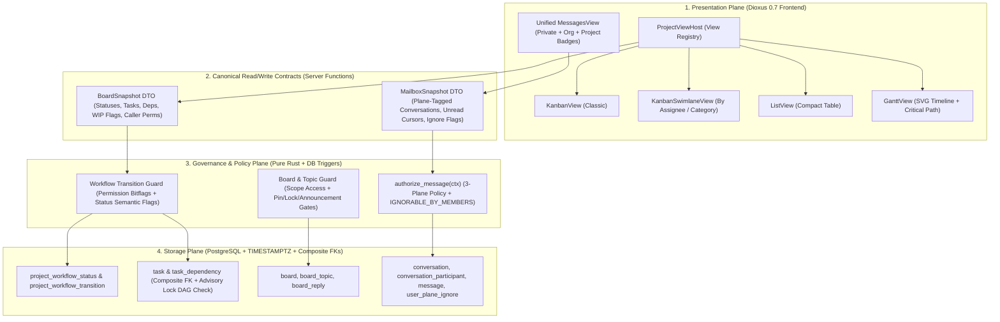
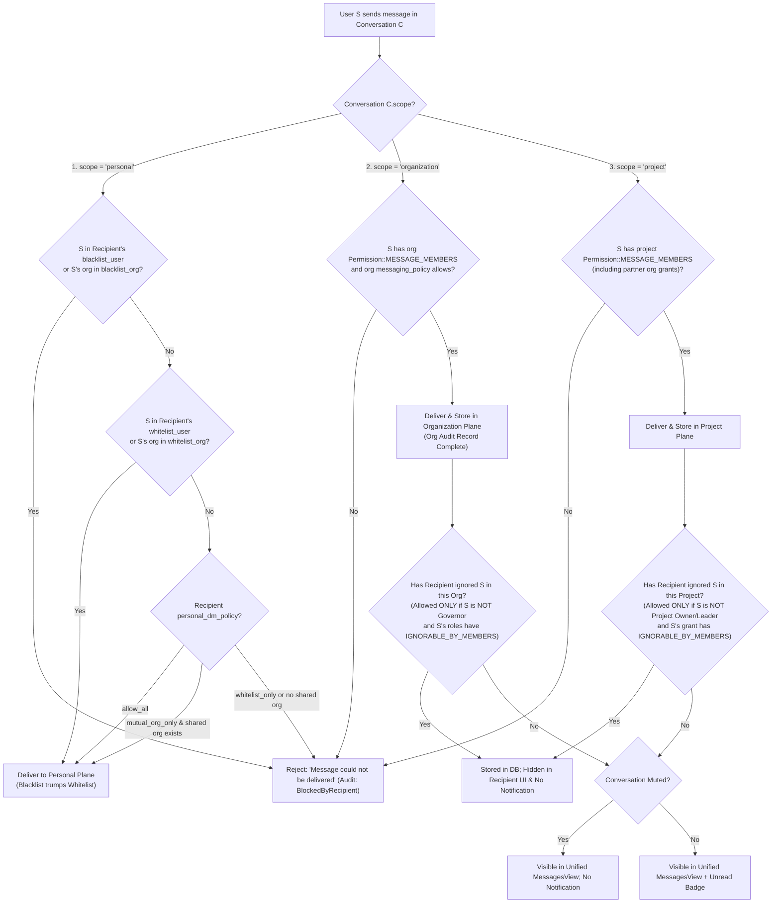
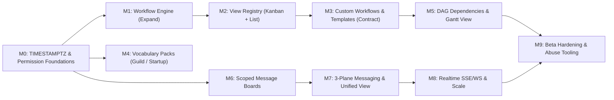

# Principal Architect Review — Taskmaster Extensibility & Communication Plan

**Reviewed Plan:** [taskmster-initial-extensibility-plan.md](file:///home/eikj/repos/tutorials/webdev/todolist/taskmster-initial-extensibility-plan.md) ([artifact copy](file:///home/eikj/.gemini/antigravity/brain/e78c5cb3-16f9-4548-b6b3-95b92b8c1573/taskmaster_extensibility_and_communication_plan.md))  
**Codebase Baseline Verified Against:** [0001_initial_schema.sql](file:///home/eikj/repos/tutorials/webdev/todolist/migrations/0001_initial_schema.sql), [0003_task_state_triggers.sql](file:///home/eikj/repos/tutorials/webdev/todolist/migrations/0003_task_state_triggers.sql), [tasks.rs](file:///home/eikj/repos/tutorials/webdev/todolist/src/backend/app_endpoints/tasks.rs), [projects.rs](file:///home/eikj/repos/tutorials/webdev/todolist/src/backend/app_endpoints/projects.rs), [organizations.rs](file:///home/eikj/repos/tutorials/webdev/todolist/src/backend/app_endpoints/organizations.rs), [board.rs](file:///home/eikj/repos/tutorials/webdev/todolist/src/components/tasks/board.rs), and [types.rs](file:///home/eikj/repos/tutorials/webdev/todolist/src/types.rs).

---

## 1. Executive Verdict

**Strategic direction approved; initial engineering specification rejected in its current form and superseded by the revised architecture below.**

The product thesis—bridging **gaming guilds/communities** (which outgrow Discord pins and ad-hoc spreadsheets) and **agile startups** (which want fast, low-ceremony task, timeline, and communication tooling)—is sound. The engineering team correctly identified the three core capability pillars:
1. Configurable project workflows and timeline/Gantt projection,
2. Scoped asynchronous discussion boards, and
3. Governance-aware direct and group messaging.

However, the initial plan ([taskmster-initial-extensibility-plan.md](file:///home/eikj/repos/tutorials/webdev/todolist/taskmster-initial-extensibility-plan.md)) was written against an idealized greenfield schema rather than our actual production schema and triggers, and it conflated **three orthogonal architectural planes**:
- **Workflow Definition** (*what states exist and what invariants govern them*),
- **Governance Policy** (*who may transition work, moderate discussions, or send/ignore messages in a given scope*), and
- **View Presentation** (*how a project's state is rendered—Classic Kanban, Swimlane Kanban, List, Gantt, or Unified Inbox*).

This review completes the architectural audit, incorporates all of the **Project Leader's (PL) binding review comments and decisions**, resolves every schema and concurrency defect, and establishes the execution milestones (**M0–M9**) and risk-driven test campaigns (**TC0–TC8**).

---

## 2. Critical Findings (Severity-Ranked)

| ID | Severity | Finding | Evidence in Codebase & Initial Plan |
|---|---|---|---|
| **F1** | 🔴 Blocker | **Schema mismatch & split timestamp convention.** The initial plan references plural tables (`projects`, `users`, `organizations`, `tasks`) that do not exist. Our schema uses singular names (`project`, `"user"`, `organization`, `task`). Furthermore, existing tables use `BIGINT` epoch seconds whereas the new tables in the plan use `TIMESTAMPTZ`. | [0001_initial_schema.sql](file:///home/eikj/repos/tutorials/webdev/todolist/migrations/0001_initial_schema.sql) vs. Plan §1–§3 |
| **F2** | 🔴 Blocker | **Workflow state invariants are hardcoded across 3 layers.** DB triggers match literal strings (`'suggested'`, `'in_progress'`), Rust backend handlers branch on `TaskStatus::InProgress`, and UI components iterate a fixed 5-variant enum. Replacing `status` with a foreign key without migrating these invariants to semantic status flags silently breaks task-assignment safety. | [0003_task_state_triggers.sql](file:///home/eikj/repos/tutorials/webdev/todolist/migrations/0003_task_state_triggers.sql) (triggers 3.1–3.3), [tasks.rs](file:///home/eikj/repos/tutorials/webdev/todolist/src/backend/app_endpoints/tasks.rs#L553-L578), [board.rs](file:///home/eikj/repos/tutorials/webdev/todolist/src/components/tasks/board.rs#L18-L21) |
| **F3** | 🔴 Blocker | **Conflation of workflow data model with Kanban presentation.** The initial plan treats "the Kanban board" as synonymous with the project workflow. As the PL noted, Kanban is merely one view—and we need to mount multiple Kanban variants alongside List and Gantt views over the same project data. | PL Comment on Kanban; [board.rs](file:///home/eikj/repos/tutorials/webdev/todolist/src/components/tasks/board.rs) |
| **F4** | 🔴 Blocker | **Message boards ignore standalone and multi-organization projects.** Setting `message_boards.organization_id NOT NULL` fails for standalone projects (`project.owner_org_id IS NULL`) and ignores cross-org collaboration already modeled in `project_organizations` (`owner`, `partner`, `contractor`, `auditor`) and `project_org_role_access`. | [0001_initial_schema.sql](file:///home/eikj/repos/tutorials/webdev/todolist/migrations/0001_initial_schema.sql#L60-L92) vs. Plan §2 |
| **F5** | 🟠 High | **Messaging schema is restricted to 2-party DMs and lacks project scope & transport.** `direct_conversations(user_a_id, user_b_id, organization_id)` cannot represent **project-scoped** chats or multi-member group threads, nor does the plan define a delivery mechanism (polling vs. SSE/WebSocket with Postgres `LISTEN/NOTIFY`). | Plan §3 |
| **F6** | 🟠 High | **Underspecified messaging control planes, precedence, and harassment handling.** The initial plan only separated org vs. personal DMs, lacked a third plane for projects, leaked block status in error strings, and gave members no relief from intra-org harassment if blocking was forbidden. | Plan §3 Flowchart; PL Comments on F6 & Q1/Q3 |
| **F7** | 🟠 High | **`organization_role` has no permissions mask.** `organization_role` currently stores only `(organization_id, role)` with no `permissions_mask`. Organization boards, announcement gates, org messaging policies, and role-based ignore capabilities (`IGNORABLE_BY_MEMBERS`) cannot be enforced without org-level permission bitflags. | [0001_initial_schema.sql](file:///home/eikj/repos/tutorials/webdev/todolist/migrations/0001_initial_schema.sql#L31-L35) |
| **F8** | 🟠 High | **`ON DELETE CASCADE` on `author_id` / `sender_id` destroys organizational records.** Cascading user deletion onto `board_topics`, `board_replies`, and messages wipes out half of every thread and audit log when an account is deleted. Our existing `task` table already uses `ON DELETE SET NULL`. | [0001_initial_schema.sql](file:///home/eikj/repos/tutorials/webdev/todolist/migrations/0001_initial_schema.sql#L106) vs. Plan §2–§3; PL Comment on Q2 |
| **F9** | 🟠 High | **Unaddressed concurrency and integrity hazards.** (a) Concurrent dependency inserts `A → B` and `B → A` both pass naive application-level cycle checks unless serialized per project; (b) `task_dependencies` lacks composite FKs to guarantee both tasks belong to the same `project_id`; (c) `task.workflow_status_id ON DELETE SET NULL` orphans tasks from boards instead of restricting deletion until remapped; (d) `INT` positions require $O(N)$ re-indexing on column reorder. | Plan §1–§2 |
| **F10** | 🟡 Medium | **Magic permission bit literals scattered across SQL and Rust.** Raw integers (`1`, `4`, `32`, `63`) are hardcoded in SQL queries and PL/pgSQL triggers. Adding workflow, moderation, and messaging bits without a unified `Permission` bitflags type and SQL helper will cause subtle authorization bugs. | [projects.rs](file:///home/eikj/repos/tutorials/webdev/todolist/src/backend/app_endpoints/projects.rs), [tasks.rs](file:///home/eikj/repos/tutorials/webdev/todolist/src/backend/app_endpoints/tasks.rs), [0003_task_state_triggers.sql](file:///home/eikj/repos/tutorials/webdev/todolist/migrations/0003_task_state_triggers.sql) |
| **F11** | 🟡 Medium | **Missing domain vocabulary layer & deferred wiki boundary.** The gaming-guild vs. startup positioning benefits immensely from a zero-cost frontend **Vocabulary Pack** (`Guild / Raid / Quest` vs. `Organization / Project / Task`). Meanwhile, long-form CRDT documentation (`task.loro_snapshot`) must be explicitly marked as reserved for a later milestone. | [0001_initial_schema.sql](file:///home/eikj/repos/tutorials/webdev/todolist/migrations/0001_initial_schema.sql#L108); PL Comment on Wiki |
| **F12** | 🟡 Medium | **Test campaigns focus on happy-path features rather than systemic risks.** Missing: schema migration compatibility tests (TC0), view contract tests across all mounted board views (TC2), concurrent DAG cycle race tests, cross-org authz matrices, exhaustive messaging policy verification, XSS/CSV-injection hardening, and unsupported Mermaid `timeline` syntax. | Plan §4–§5 |

---

## 3. Resolution of Project Leader Comments & Binding Decisions

Every comment left by the Project Leader on both the initial plan and the preliminary review has been incorporated as a binding architectural constraint:

| Project Leader Comment / Directive | Architectural Resolution & Enforcement |
|---|---|
| **1. WIP Limits:** *"the `wip_limit` must either be settable by a project leader or nullable. Maybe if our database doesn't enforce going over it, application logic may for instance show warnings or something"* | **Adopted (§4.3).** `wip_limit INT NULL CHECK (wip_limit IS NULL OR wip_limit > 0)` on `project_workflow_status`, editable only by principals with `Permission::MANAGE_WORKFLOW`. Never enforced by DB triggers. Computed at read time (`count > wip_limit`) and surfaced in `BoardSnapshot` so any view (Kanban, Swimlanes, List) renders a non-blocking visual warning. |
| **2. CSS vs. DB Colors:** *"colors don't belong in the database, but in our `.css` files??"* | **Adopted with strict allow-list validation (§4.3).** Only a semantic `badge_variant` token is stored in Postgres (`CHECK (badge_variant IN ('default','info','success','warning','danger','purple','teal'))`) and mapped via a strongly-typed Rust `BadgeVariant` enum to CSS classes in [`assets/main.css`](file:///home/eikj/repos/tutorials/webdev/todolist/assets/main.css). Arbitrary strings/hex codes are rejected to prevent CSS class injection and theme breakage. |
| **3. Purpose of `is_locked`:** *"what is the `is_locked` field for?"* | **Adopted with audit metadata & server-side enforcement (§4.4).** `is_locked` freezes a board topic so regular members cannot post new replies once an announcement, vote, or retrospective is concluded. Moderators (`Permission::MODERATE_DISCUSSIONS`) can lock/unlock and still post. We add `locked_by` and `locked_at` for auditability and enforce the check in the backend reply endpoint (HTTP 403), not just the UI. |
| **4. Pluggable Frontend Board Views:** *"we currently use KanBan, and we should be able to mount different versions in the frontend"* | **Core Architectural Pillar (§4.2).** We decouple the workflow state machine from presentation via a **`ProjectViewHost` registry** over a single canonical `BoardSnapshot` DTO. Classic Kanban (`KanbanView`), Swimlane Kanban (`KanbanSwimlaneView`), `ListView`, and `GanttView` are pure Dioxus 0.7 component views mounted by route/preference without duplicating backend queries or business rules. |
| **5. Three Messaging Planes, Role-Gated Ignore, & Unified View (F6 & Q1):** *"Private out-of-org or out-of-project messages $\rightarrow$ user decides. Within-org messages $\rightarrow$ organization decides. User may blacklist individuals except organization governor, and has a `can-blacklist-roles` capability. Within-project messages $\rightarrow$ project leader sets policy. We have three different types of message boxes then. We should provide a unified message-box view in the front end."* | **Adopted as the Three-Plane Messaging Architecture (§4.5 & ADR-1).** Backend storage and policy evaluation are strictly partitioned into three independent planes: **`personal`**, **`organization`**, and **`project`**. Within any plane where a user has both a whitelist and a blacklist/ignore entry, **blacklist/ignore trumps whitelist**. In the frontend, a unified **`MessagesView`** aggregates all three mailboxes with plane badges (`Private`, `Org`, `Project`), per-plane unread counters, and instant plane filters. |
| **6. Harassment Handling via Mute + Ignore + Report + Moderator (Q3):** *"I was thinking a hard-block is an OK solution, but a mute+report+moderator can also be decent within an organization. It almost looks simpler with mute+report+moderator -- lets go for that."* | **Adopted (§4.5 & ADR-2).** In `organization` and `project` planes, delivery is governed by org/project policy so audit trails remain intact, while users have three personal controls: (1) **Mute** (suppresses notifications), (2) **Ignore / Visibility Suppression** (`user_plane_ignore`: hides messages from a specific sender in that plane's UI if the target's roles carry `Permission::IGNORABLE_BY_MEMBERS`—the "can-blacklist-roles" capability—and **never** applies to the organization governor or project owner), and (3) **Report to Moderator**, who can revoke the offender's `Permission::MESSAGE_MEMBERS` bit. |
| **7. Data Ownership, Departure Export & Message Deletion (Q2):** *"The user can keep read-only access, as an option with exporting. I think we don't need to purge anything else than the users name. However, users should be able to delete their messages if they want to do that."* | **Adopted (§4.4, §4.5 & ADR-3).** (1) Departing members (`left_at IS NOT NULL`) retain **read-only access** to their historical org/project conversations plus a one-click **JSON/Markdown export**. (2) Deleting a user account sets `author_id` / `sender_id` to `NULL` (`ON DELETE SET NULL`) and purges PII from `"user"`, rendering historical posts as `"Deleted user"`. (3) Users can delete their own messages in any plane (soft-delete tombstone: `deleted_at` set, `content` scrubbed to `""`, thread structure preserved). |
| **8. Wiki / CRDT Documentation Scope (F11 & Q4):** *"A wiki is in the project leaders vision, but not yet a priority ... This is later work, as I intend to use it for other things as well"* | **Adopted (ADR-5).** Long-form wiki/documentation is explicitly deferred beyond M0–M9. `task.loro_snapshot BYTEA` remains untouched and reserved in the schema. |
| **9. Timestamp Unification (Q5):** *"We can go to a `timestamptz` across the board"* | **Adopted (§4.6 & ADR-4).** In **M0**, a dedicated migration converts all existing `BIGINT` epoch columns across `"user"`, `session`, `organization`, `organization_members`, `project`, `project_organizations`, `project_members`, `task`, `task_message`, and `user_inbox_message` to `TIMESTAMPTZ NOT NULL DEFAULT NOW()` via `to_timestamp(...)`. All new tables use `TIMESTAMPTZ` natively. |

---

## 4. Revised System Architecture & Concrete Solutions

### 4.1 Architectural Layering: Flow vs. Policy vs. Presentation



**Core Architectural Invariants:**
1. **Views are pure projections:** Frontend view components never hardcode status names or permission rules; they render a `BoardSnapshot` and emit semantic intent events (`TaskMove`, `TaskCreate`, `DependencyAdd`).
2. **Single policy enforcement point:** Every state transition and message dispatch passes through a deterministic Rust guard backed by database integrity constraints.
3. **Workflow definitions are data:** Templates are copied into `project_workflow_status` and `project_workflow_transition` when a project is created; editing a template later never mutates running projects.

---

### 4.2 Pluggable Frontend View Registry (`ProjectViewHost`)

To satisfy the PL's requirement that Kanban be swappable with alternate Kanban versions, List views, and Gantt charts without backend churn, we introduce a unified `BoardSnapshot` contract and `ProjectViewHost` component in Dioxus 0.7:

```rust
#[derive(Debug, Clone, Copy, PartialEq, Eq, serde::Serialize, serde::Deserialize)]
pub enum ProjectViewKind {
    KanbanClassic,
    KanbanSwimlanes,
    List,
    Gantt,
}

#[derive(Debug, Clone, PartialEq, serde::Serialize, serde::Deserialize)]
pub struct WorkflowStatusDto {
    pub id: i64,
    pub name: String,
    pub category: StatusCategory,
    pub badge_variant: BadgeVariant,
    pub position: i64,
    pub wip_limit: Option<i32>,
    pub task_count: usize,
    pub wip_exceeded: bool, // Computed: wip_limit.is_some_and(|limit| task_count > limit as usize)
    pub is_initial: bool,
    pub allows_assignment: bool,
    pub requires_assignee: bool,
}

#[derive(Debug, Clone, PartialEq, serde::Serialize, serde::Deserialize)]
pub struct BoardSnapshot {
    pub project_id: i64,
    pub enabled_views: Vec<ProjectViewKind>,
    pub default_view: ProjectViewKind,
    pub caller_permissions: u64,
    pub statuses: Vec<WorkflowStatusDto>,
    pub tasks: Vec<TaskDto>,
    pub dependencies: Vec<TaskDependencyDto>,
}

#[component]
pub fn ProjectViewHost(
    view_kind: ReadOnlySignal<ProjectViewKind>,
    board: ReadOnlySignal<BoardSnapshot>,
    on_move_task: EventHandler<TaskMoveRequest>,
) -> Element {
    match view_kind() {
        ProjectViewKind::KanbanClassic => rsx! { KanbanClassicView { board, on_move_task } },
        ProjectViewKind::KanbanSwimlanes => rsx! { KanbanSwimlanesView { board, on_move_task } },
        ProjectViewKind::List => rsx! { ListView { board, on_move_task } },
        ProjectViewKind::Gantt => rsx! { GanttView { board } },
    }
}
```

- **Deep-Linkable Routing:** `#[route("/projects/:project_id/board/:view")]` mounts `ProjectViewHost` with the selected `ProjectViewKind`.
- **Hydration-Safe View Persistence:** If a user prefers `KanbanSwimlanes` over the project's `default_view`, that client preference is read from `localStorage` inside a `use_effect` hook *after* hydration so initial SSR HTML matches client hydration identically.
- **Cross-Project "My Tasks" Aggregation:** Because every project can define custom status names, the global dashboard (`project_id: None`) groups tasks by `StatusCategory` (`todo`, `in_progress`, `review`, `done`, `archived`) rather than raw status names.

---

### 4.3 Customizable Project Workflows, Semantic Flags & Safe Dependencies (Fixes F1, F2, F9)

Currently, [`migrations/0003_task_state_triggers.sql`](file:///home/eikj/repos/tutorials/webdev/todolist/migrations/0003_task_state_triggers.sql) hardcodes three state invariants on literal status strings:
1. Trigger 3.1 (`fn_check_assignment_insert`): Tasks in `'suggested'` cannot be assigned.
2. Trigger 3.2 (`fn_enforce_in_progress_assigned`): Tasks entering `'in_progress'` must have at least one assignee.
3. Trigger 3.3 (`fn_prevent_unassign_in_progress_task`): The last assignee cannot be removed while a task is `'in_progress'`.

We preserve all three invariants dynamically by promoting them to **boolean semantic flags** (`is_initial`, `allows_assignment`, `requires_assignee`) on `project_workflow_status`:

```sql
CREATE TABLE project_workflow_status (
    id BIGSERIAL PRIMARY KEY,
    project_id BIGINT NOT NULL REFERENCES project(id) ON DELETE CASCADE,
    name VARCHAR(60) NOT NULL,
    category TEXT NOT NULL DEFAULT 'todo'
        CHECK (category IN ('todo', 'in_progress', 'review', 'done', 'archived')),
    badge_variant TEXT NOT NULL DEFAULT 'default'
        CHECK (badge_variant IN ('default', 'info', 'success', 'warning', 'danger', 'purple', 'teal')),
    -- Gap-indexed (1000, 2000, 3000...) so inserting/reordering a column is an O(1) single-row UPDATE
    position BIGINT NOT NULL,
    -- Nullable soft WIP limit: settable by project leader (MANAGE_WORKFLOW); never blocks DB writes
    wip_limit INT NULL CHECK (wip_limit IS NULL OR wip_limit > 0),
    -- Semantic flags replacing hardcoded 'suggested' / 'in_progress' checks in 0003_task_state_triggers.sql
    is_initial BOOLEAN NOT NULL DEFAULT FALSE,
    allows_assignment BOOLEAN NOT NULL DEFAULT TRUE,
    requires_assignee BOOLEAN NOT NULL DEFAULT FALSE,
    created_at TIMESTAMPTZ NOT NULL DEFAULT NOW(),
    UNIQUE (project_id, id),
    UNIQUE (project_id, name)
);

-- Exactly one initial landing status per project
CREATE UNIQUE INDEX idx_one_initial_status_per_project
    ON project_workflow_status(project_id)
    WHERE is_initial = TRUE;

-- Optional role-gated workflow transitions (if a project defines 0 rows, any-to-any is allowed)
CREATE TABLE project_workflow_transition (
    project_id BIGINT NOT NULL,
    from_status_id BIGINT NOT NULL,
    to_status_id BIGINT NOT NULL,
    required_permission BIGINT NOT NULL DEFAULT 4, -- Permission::EXECUTE
    PRIMARY KEY (project_id, from_status_id, to_status_id),
    FOREIGN KEY (project_id, from_status_id)
        REFERENCES project_workflow_status(project_id, id) ON DELETE CASCADE,
    FOREIGN KEY (project_id, to_status_id)
        REFERENCES project_workflow_status(project_id, id) ON DELETE CASCADE
);

-- Composite key support on task so cross-project status or dependency links are impossible
ALTER TABLE task
    ADD CONSTRAINT uq_task_project_id_id UNIQUE (project_id, id),
    ADD COLUMN workflow_status_id BIGINT,
    ADD COLUMN start_date TIMESTAMPTZ,
    ADD COLUMN due_date TIMESTAMPTZ,
    ADD COLUMN estimated_hours INT CHECK (estimated_hours IS NULL OR estimated_hours >= 0),
    ADD COLUMN progress_percent INT NOT NULL DEFAULT 0 CHECK (progress_percent BETWEEN 0 AND 100),
    ADD CONSTRAINT chk_task_dates CHECK (due_date IS NULL OR start_date IS NULL OR due_date >= start_date),
    ADD CONSTRAINT fk_task_workflow_status
        FOREIGN KEY (project_id, workflow_status_id)
        REFERENCES project_workflow_status(project_id, id)
        ON DELETE RESTRICT; -- Never orphan tasks silently; require explicit status remap on column delete

CREATE TABLE task_dependency (
    id BIGSERIAL PRIMARY KEY,
    project_id BIGINT NOT NULL REFERENCES project(id) ON DELETE CASCADE,
    predecessor_task_id BIGINT NOT NULL,
    successor_task_id BIGINT NOT NULL,
    dependency_type TEXT NOT NULL DEFAULT 'finish_to_start'
        CHECK (dependency_type IN ('finish_to_start', 'start_to_start', 'finish_to_finish', 'start_to_finish')),
    created_at TIMESTAMPTZ NOT NULL DEFAULT NOW(),
    CONSTRAINT uq_dependency_pair UNIQUE (predecessor_task_id, successor_task_id),
    CONSTRAINT chk_no_self_dependency CHECK (predecessor_task_id != successor_task_id),
    -- Composite FKs guarantee both tasks belong to this exact project_id
    FOREIGN KEY (project_id, predecessor_task_id) REFERENCES task(project_id, id) ON DELETE CASCADE,
    FOREIGN KEY (project_id, successor_task_id)   REFERENCES task(project_id, id) ON DELETE CASCADE
);
```

- **Race-Free DAG Cycle Detection:** Before inserting into `task_dependency`, the transaction acquires `SELECT pg_advisory_xact_lock(hashtext('task_dep'), project_id::int)` and runs a recursive CTE reachability check from `successor_task_id` to `predecessor_task_id`. Concurrent transactions inserting `A → B` and `B → A` are serialized per project, guaranteeing that the second transaction deterministically fails with HTTP 400 (`Circular dependency detected`).
- **Zero-Downtime Expand $\rightarrow$ Migrate $\rightarrow$ Contract:**
  1. *Expand (M1):* Create `project_workflow_status` and backfill every existing project with the 5-state "Legacy Flow" (`Suggested` [`is_initial=true, allows_assignment=false`], `Accepted`, `Assigned`, `InProgress` [`requires_assignee=true`], `Finished`). Rewrite triggers 3.1–3.3 to inspect `project_workflow_status` flags.
  2. *Migrate (M2):* Switch `BoardSnapshot` and all views (`KanbanClassicView`, `ListView`) to read `workflow_status_id`.
  3. *Contract (M3):* Drop the legacy `task.status` text column and `TaskStatus` enum, making `workflow_status_id` `NOT NULL`.

---

### 4.4 Scoped Discussion Boards & Shared Content Safety Pipeline (Fixes F4, F8)

Because a project in Taskmaster can be standalone (`owner_org_id IS NULL`) or shared across multiple organizations (`project_organizations`), a board belongs to **either** an organization **or** a project (`num_nonnulls(organization_id, project_id) = 1`):

```sql
CREATE TABLE board (
    id BIGSERIAL PRIMARY KEY,
    organization_id BIGINT REFERENCES organization(id) ON DELETE CASCADE,
    project_id BIGINT REFERENCES project(id) ON DELETE CASCADE,
    name VARCHAR(100) NOT NULL,
    description TEXT,
    is_announcements_only BOOLEAN NOT NULL DEFAULT FALSE,
    created_at TIMESTAMPTZ NOT NULL DEFAULT NOW(),
    CONSTRAINT chk_board_single_scope CHECK (num_nonnulls(organization_id, project_id) = 1)
);

CREATE TABLE board_topic (
    id BIGSERIAL PRIMARY KEY,
    board_id BIGINT NOT NULL REFERENCES board(id) ON DELETE CASCADE,
    author_id BIGINT REFERENCES "user"(id) ON DELETE SET NULL, -- Retain post if user deletes account
    title VARCHAR(255) NOT NULL,
    content TEXT NOT NULL,
    is_pinned BOOLEAN NOT NULL DEFAULT FALSE,
    is_locked BOOLEAN NOT NULL DEFAULT FALSE,
    locked_by BIGINT REFERENCES "user"(id) ON DELETE SET NULL,
    locked_at TIMESTAMPTZ,
    reply_count INT NOT NULL DEFAULT 0,
    last_activity_at TIMESTAMPTZ NOT NULL DEFAULT NOW(),
    deleted_at TIMESTAMPTZ,
    deleted_by BIGINT REFERENCES "user"(id) ON DELETE SET NULL,
    created_at TIMESTAMPTZ NOT NULL DEFAULT NOW(),
    updated_at TIMESTAMPTZ NOT NULL DEFAULT NOW()
);

CREATE TABLE board_reply (
    id BIGSERIAL PRIMARY KEY,
    topic_id BIGINT NOT NULL REFERENCES board_topic(id) ON DELETE CASCADE,
    author_id BIGINT REFERENCES "user"(id) ON DELETE SET NULL,
    content TEXT NOT NULL,
    deleted_at TIMESTAMPTZ,
    deleted_by BIGINT REFERENCES "user"(id) ON DELETE SET NULL,
    created_at TIMESTAMPTZ NOT NULL DEFAULT NOW(),
    updated_at TIMESTAMPTZ NOT NULL DEFAULT NOW()
);

CREATE INDEX idx_board_topic_listing
    ON board_topic(board_id, is_pinned DESC, last_activity_at DESC, id DESC);
CREATE INDEX idx_board_reply_thread
    ON board_reply(topic_id, created_at ASC, id ASC);
```

- **Multi-Organization & Standalone Project Access:** Project boards reuse `verify_project_access`. Partner, contractor, and auditor organizations linked via `project_organizations` and `project_org_role_access` automatically receive board visibility and posting rights matching their effective project permission mask (e.g., auditor orgs have `Permission::READ` only, so they can read project boards but cannot post or reply).
- **Atomic Counters & Keyset Pagination:** Inserting a non-deleted reply atomically executes `UPDATE board_topic SET reply_count = reply_count + 1, last_activity_at = NOW() WHERE id = $1` in the same SQL transaction. Topic listings use keyset pagination on `(is_pinned, last_activity_at, id)`.

---

### 4.5 Three-Plane Messaging Architecture & Unified Frontend `MessagesView` (Fixes F5, F6, F8; Implements ADR-1, ADR-2, ADR-3)

Per the Project Leader's architecture directive, messaging is partitioned into **three strictly independent control planes** in the backend while presented through a **single unified `MessagesView`** in the frontend.



#### Summary of the Three Messaging Planes

| Plane (`scope`) | Mailbox Purpose | Policy Owner | Who Can Send | Recipient Controls (Precedence: Block/Ignore > Whitelist) |
|---|---|---|---|---|
| **`personal`** | Private user-to-user messages outside any org/project governance | **The User** | Governed by recipient's `user_privacy_settings` & `user_privacy_rules` | Full `blacklist_user`, `blacklist_org`, `whitelist_user`, `whitelist_org`, `contact_request`, and `personal_dm_policy` (`allow_all`, `mutual_org_only`, `whitelist_only`). **Blacklist always trumps whitelist.** |
| **`organization`** | Intra-org 1:1 & group chats, guild officer channels, org-linked general chats | **Organization Governor** | Active org members whose `organization_role.permissions_mask` includes `MESSAGE_MEMBERS` | **Mute** (always), **Report to Org Moderator** (always), and **Ignore user in Org** (`user_plane_ignore`) *if and only if* the sender is **not** the org governor and all of the sender's active roles in that org carry `Permission::IGNORABLE_BY_MEMBERS` ("can-blacklist-roles"). |
| **`project`** | Within-project 1:1 & group chats (including cross-org partner/contractor members) | **Project Leader** | Active project members (direct or via `project_org_role_access`) with `MESSAGE_MEMBERS` | **Mute** (always), **Report to Project Moderator** (always), and **Ignore user in Project** (`user_plane_ignore`) *if and only if* the sender is **not** the project owner/leader and the sender's effective project role carries `Permission::IGNORABLE_BY_MEMBERS`. |

#### Messaging Database Schema (`TIMESTAMPTZ` & Retention-Safe)

```sql
-- 1. Personal Plane privacy settings & rules
CREATE TABLE user_privacy_settings (
    user_id BIGINT PRIMARY KEY REFERENCES "user"(id) ON DELETE CASCADE,
    personal_dm_policy TEXT NOT NULL DEFAULT 'mutual_org_only'
        CHECK (personal_dm_policy IN ('allow_all', 'mutual_org_only', 'whitelist_only')),
    updated_at TIMESTAMPTZ NOT NULL DEFAULT NOW()
);

CREATE TABLE user_privacy_rule (
    id BIGSERIAL PRIMARY KEY,
    user_id BIGINT NOT NULL REFERENCES "user"(id) ON DELETE CASCADE,
    rule_kind TEXT NOT NULL
        CHECK (rule_kind IN ('blacklist_user', 'whitelist_user', 'blacklist_org', 'whitelist_org')),
    target_id BIGINT NOT NULL,
    note VARCHAR(100),
    created_at TIMESTAMPTZ NOT NULL DEFAULT NOW(),
    UNIQUE (user_id, rule_kind, target_id)
);

CREATE TABLE contact_request (
    id BIGSERIAL PRIMARY KEY,
    sender_id BIGINT NOT NULL REFERENCES "user"(id) ON DELETE CASCADE,
    recipient_id BIGINT NOT NULL REFERENCES "user"(id) ON DELETE CASCADE,
    status TEXT NOT NULL DEFAULT 'pending'
        CHECK (status IN ('pending', 'accepted', 'declined')),
    created_at TIMESTAMPTZ NOT NULL DEFAULT NOW(),
    updated_at TIMESTAMPTZ NOT NULL DEFAULT NOW(),
    UNIQUE (sender_id, recipient_id),
    CHECK (sender_id != recipient_id)
);

-- 2. Scoped Conversations (supports both 1:1 and multi-member group threads across all 3 planes)
CREATE TABLE conversation (
    id BIGSERIAL PRIMARY KEY,
    scope TEXT NOT NULL CHECK (scope IN ('personal', 'organization', 'project')),
    organization_id BIGINT REFERENCES organization(id) ON DELETE CASCADE,
    project_id BIGINT REFERENCES project(id) ON DELETE CASCADE,
    title VARCHAR(120), -- NULL for 1:1 threads, populated for named group channels
    is_direct_pair BOOLEAN NOT NULL DEFAULT TRUE,
    created_at TIMESTAMPTZ NOT NULL DEFAULT NOW(),
    last_message_at TIMESTAMPTZ NOT NULL DEFAULT NOW(),
    CONSTRAINT chk_conversation_plane CHECK (
        (scope = 'personal'     AND organization_id IS NULL     AND project_id IS NULL) OR
        (scope = 'organization' AND organization_id IS NOT NULL AND project_id IS NULL) OR
        (scope = 'project'      AND project_id IS NOT NULL      AND organization_id IS NULL)
    )
);

CREATE TABLE conversation_participant (
    conversation_id BIGINT NOT NULL REFERENCES conversation(id) ON DELETE CASCADE,
    user_id BIGINT NOT NULL REFERENCES "user"(id) ON DELETE CASCADE,
    last_read_message_id BIGINT,
    muted BOOLEAN NOT NULL DEFAULT FALSE,
    joined_at TIMESTAMPTZ NOT NULL DEFAULT NOW(),
    -- When a member leaves an org/project, left_at is stamped:
    -- they retain read-only access to messages up to left_at + JSON/Markdown export.
    left_at TIMESTAMPTZ,
    PRIMARY KEY (conversation_id, user_id)
);

CREATE TABLE message (
    id BIGSERIAL PRIMARY KEY,
    conversation_id BIGINT NOT NULL REFERENCES conversation(id) ON DELETE CASCADE,
    sender_id BIGINT REFERENCES "user"(id) ON DELETE SET NULL, -- Account deletion => "Deleted user"
    content TEXT NOT NULL,
    -- Users can soft-delete their own messages (and moderators can delete within their scope):
    -- content is cleared to '' and deleted_at is stamped, preserving thread integrity.
    deleted_at TIMESTAMPTZ,
    deleted_by BIGINT REFERENCES "user"(id) ON DELETE SET NULL,
    created_at TIMESTAMPTZ NOT NULL DEFAULT NOW(),
    edited_at TIMESTAMPTZ
);

CREATE INDEX idx_message_conv_cursor ON message(conversation_id, id DESC);

-- 3. Scoped Ignore List for Organization and Project planes (governed by IGNORABLE_BY_MEMBERS)
CREATE TABLE user_plane_ignore (
    id BIGSERIAL PRIMARY KEY,
    user_id BIGINT NOT NULL REFERENCES "user"(id) ON DELETE CASCADE,
    ignored_user_id BIGINT NOT NULL REFERENCES "user"(id) ON DELETE CASCADE,
    scope TEXT NOT NULL CHECK (scope IN ('organization', 'project')),
    organization_id BIGINT REFERENCES organization(id) ON DELETE CASCADE,
    project_id BIGINT REFERENCES project(id) ON DELETE CASCADE,
    created_at TIMESTAMPTZ NOT NULL DEFAULT NOW(),
    CHECK (user_id != ignored_user_id),
    CHECK (
        (scope = 'organization' AND organization_id IS NOT NULL AND project_id IS NULL) OR
        (scope = 'project'      AND project_id IS NOT NULL      AND organization_id IS NULL)
    ),
    UNIQUE NULLS NOT DISTINCT (user_id, ignored_user_id, scope, organization_id, project_id)
);

-- 4. Harassment & Abuse Moderation Report Queue
CREATE TABLE message_report (
    id BIGSERIAL PRIMARY KEY,
    message_id BIGINT NOT NULL REFERENCES message(id) ON DELETE CASCADE,
    reporter_id BIGINT REFERENCES "user"(id) ON DELETE SET NULL,
    reason TEXT NOT NULL,
    status TEXT NOT NULL DEFAULT 'open' CHECK (status IN ('open', 'resolved', 'dismissed')),
    resolved_by BIGINT REFERENCES "user"(id) ON DELETE SET NULL,
    resolved_at TIMESTAMPTZ,
    created_at TIMESTAMPTZ NOT NULL DEFAULT NOW()
);
```

#### Unified Frontend `MessagesView` & Privacy Guarantees
- **Unified Mailbox UI (`MessagesView`):** Users open a single `/messages` route in the Dioxus frontend. A top filter bar lets them toggle `All Planes`, `Private`, `Organizations` (with org selector), and `Projects` (with project selector). Every thread row displays a semantic plane pill (`Private`, `Org: <Name>`, `Project: <Name>`) and per-plane unread badge.
- **Dynamic Ignore Evaluation:** Even if User B adds User A to `user_plane_ignore` when User A is a regular member, the read query evaluates `IGNORABLE_BY_MEMBERS` dynamically against User A's *current* roles. If User A is later promoted to Organization Governor or an Officer role without `IGNORABLE_BY_MEMBERS`, User A's official messages automatically become visible again.
- **Opaque Error Responses:** Any rejected send or contact request returns a uniform `"Message could not be delivered"` error to the caller; the specific `DenyReason` is recorded only in server-side audit logs to prevent blocklist enumeration.
- **Departure Read-Only & Export:** When `conversation_participant.left_at` is set, the user can no longer post to that conversation and only queries messages where `message.created_at <= participant.left_at`. A `/api/conversations/:id/export?format=json|md` endpoint lets the user download their historical transcript.

---

### 4.6 Cross-Cutting Foundations (Fixes F1, F7, F10, F11)

1. **System-Wide `TIMESTAMPTZ` Unification (ADR-4):**
   - In **M0**, migration `0004_timestamptz_and_permissions.sql` converts all existing `BIGINT` epoch columns (`"user".created_at`, `session.expires_at/created_at`, `organization.created_at`, `organization_members.joined_at`, `project.created_at`, `project_organizations.joined_at`, `project_members.joined_at`, `task.created_at/completed_at`, `task_message.created_at/updated_at`, `user_inbox_message.created_at`) to `TIMESTAMPTZ` using `to_timestamp(col)`.
   - Rust models standardize on `chrono::DateTime<chrono::Utc>` (with `sqlx` `chrono` feature).
2. **Typed `Permission` Bitflags & `organization_role.permissions_mask` (Fixes F7, F10):**
   - Add `permissions_mask BIGINT NOT NULL DEFAULT 0` to `organization_role`.
   - Centralize all permission constants in [`src/types.rs`](file:///home/eikj/repos/tutorials/webdev/todolist/src/types.rs) and provide a matching SQL function `has_perm(mask BIGINT, required BIGINT) RETURNS BOOLEAN`:
     - Bit 0 (`1`): `READ`
     - Bit 1 (`2`): `SUGGEST` / `COMMENT`
     - Bit 2 (`4`): `EXECUTE` (edit/move tasks)
     - Bit 3 (`8`): `ASSIGN`
     - Bit 4 (`16`): `MANAGE_MEMBERS`
     - Bit 5 (`32`): `ADMIN` / `GOVERNOR` (un-ignorable in org/project scope)
     - Bit 6 (`64`): `MANAGE_WORKFLOW` (configure statuses, transitions, WIP limits, enabled views)
     - Bit 7 (`128`): `MODERATE_DISCUSSIONS` (pin/lock topics, delete abusive posts/messages, handle reports)
     - Bit 8 (`256`): `POST_ANNOUNCEMENTS` (create topics in `is_announcements_only` boards)
     - Bit 9 (`512`): `MESSAGE_MEMBERS` (send messages in org/project scope; revocable by moderators on harassment report)
     - Bit 10 (`1024`): `IGNORABLE_BY_MEMBERS` (the PL's `"can-blacklist-roles"` capability: members may ignore/suppress messages from holders of this role in org/project planes; `ADMIN`/`GOVERNOR` is never ignorable)
3. **Frontend Vocabulary Packs (Fixes F11):**
   - Add `vocabulary_pack TEXT NOT NULL DEFAULT 'standard' CHECK (vocabulary_pack IN ('standard', 'guild', 'studio'))` on `organization`.
   - Resolved purely in the Dioxus UI via a lightweight lookup (`Organization` $\leftrightarrow$ `Guild` $\leftrightarrow$ `Studio`; `Project` $\leftrightarrow$ `Raid / Campaign`; `Task` $\leftrightarrow$ `Quest / Objective`). Database schemas, API routes, and logs remain strictly canonical.

---

## 5. Enhanced Risk-Driven Test Campaigns (TC0–TC8)

All campaigns execute via `./launch.sh --test-all`. Concurrency-sensitive suites must pass both with `--threads 1` (verifying test isolation) and default multi-threaded execution (exposing race conditions).

| Campaign | Target Subsystem & Risk | Mandatory Acceptance Criteria |
|---|---|---|
| **TC0: Schema Migration & `TIMESTAMPTZ` Compatibility** *(Gates M0 & M1)* | Zero-regression migration of live data | 1. Seed a fixture database using `0001`–`0003` with `BIGINT` epoch timestamps, tasks in all 5 states, and active assignments.<br>2. Run `0004` (`TIMESTAMPTZ` + `Permission` helpers) and `0005` (Workflow expand + Legacy Flow backfill); verify idempotency and exact timestamp preservation (`EXTRACT(EPOCH FROM col) == old_epoch`).<br>3. All existing **26 backend integration tests** and **7 Dioxus SSR tests** pass without modification.<br>4. All 3 task-assignment invariants from `0003` hold via `is_initial`, `allows_assignment`, and `requires_assignee` flags. |
| **TC1: Workflow Engine & Soft WIP Limits** | Custom pipeline invariants & transition guards | 1. Creating a project with *Classic Kanban*, *Guild Raid Prep*, or *Software Sprint* instantiates the expected ordered statuses and semantic flags.<br>2. Attempting to delete a status with assigned tasks fails with `ON DELETE RESTRICT` unless a remap target status ID is supplied.<br>3. Moving a task across a role-gated `project_workflow_transition` without the required permission bit fails with HTTP 403.<br>4. Moving a $(k+1)$-th task into a status with `wip_limit = k` **succeeds** in Postgres and returns `wip_exceeded: true` in `BoardSnapshot`.<br>5. Composite FK rejects assigning a task to a `workflow_status_id` belonging to another project. |
| **TC2: Pluggable View Registry Contract** *(Addresses PL Kanban Comment)* | Presentation decoupling & SSR determinism | 1. Render a shared corpus of `BoardSnapshot` fixtures (empty project, single status, 10 custom statuses, WIP limit exceeded, 250 tasks, Unicode/markdown titles) through **every** `ProjectViewKind` (`KanbanClassic`, `KanbanSwimlanes`, `List`, `Gantt`) in an in-memory Dioxus `VirtualDom`.<br>2. Verify every task ID is rendered once in `KanbanClassic` and `List`, WIP warning CSS classes appear when `wip_exceeded == true`, and only allowed `badge_variant` classes are emitted.<br>3. Verify zero browser-only API calls occur during SSR (`localStorage` preference runs strictly inside `use_effect`). |
| **TC3: DAG Dependencies & Gantt Export Safety** | Cycle prevention under concurrency & export sanitization | 1. **Concurrent Race Test:** Spawn two parallel tasks inserting `Task A → Task B` and `Task B → Task A` simultaneously on the same project; verify per-project advisory locking ensures exactly one succeeds and one returns HTTP 400 (`Circular dependency detected`).<br>2. Property-based random DAG generator verifies multi-hop cycles ($A \rightarrow B \rightarrow C \rightarrow A$) and self-loops ($A \rightarrow A$) are rejected.<br>3. Cross-project dependency edges are rejected by composite FKs.<br>4. Golden-file snapshot tests verify Mermaid `gantt` syntax and CSV exports.<br>5. **CSV Injection Test:** Task titles starting with `=`, `+`, `-`, or `@` are escaped in CSV output so spreadsheet software cannot execute formulas. |
| **TC4: Multi-Org & Standalone Discussion Boards** | Scope isolation, moderation, & tombstone retention | 1. **Table-Driven Authz Matrix:** Test `{Owner Org Admin, Owner Org Member, Partner Org Member, Contractor Org Member, Auditor Org Member, Standalone Project Member, Non-Member}` $\times$ `{View Board, Create Topic, Post Announcement, Reply, Pin, Lock, Delete Post}`.<br>2. Replies to a topic with `is_locked = true` by non-moderators fail server-side with HTTP 403.<br>3. Deleting a user account sets `author_id = NULL` (`ON DELETE SET NULL`), keeps all topics/replies intact, and renders `"Deleted user"` in SSR.<br>4. 50 concurrent replies to the same topic produce an exact `reply_count = 50` with stable keyset pagination. |
| **TC5: Three-Plane Messaging & `IGNORABLE_BY_MEMBERS` Policy** | Exhaustive plane isolation, precedence, & retention | 1. **Exhaustive State-Space Unit Test** on pure `authorize_message(ctx)` and visibility filter across `Plane (Personal, Org, Project)` $\times$ `Sender Role (Governor/Owner, Non-Ignorable Officer, Ignorable Member, Revoked Member)` $\times$ `Recipient Rules (Blacklist User/Org, Whitelist User/Org, Plane Ignore, Mute)`.<br>2. **Plane Independence Invariant:** A `personal` blacklist or `whitelist_only` setting never blocks or hides messages in `organization` or `project` planes, and vice versa.<br>3. **Intra-Plane Precedence Invariant:** Within any plane, a blacklist/ignore rule always trumps a whitelist rule.<br>4. **Governor & Role Invariant:** Attempting to ignore an Organization Governor, Project Owner, or a role lacking `Permission::IGNORABLE_BY_MEMBERS` is rejected/bypassed; promoting an ignored member to a non-ignorable role immediately restores visibility of their org/project messages.<br>5. **Audit & Harassment Invariant:** Ignored org/project messages are still persisted in `message` and visible to moderators; reporting a message allows a moderator to revoke `Permission::MESSAGE_MEMBERS`.<br>6. **Departure & Tombstone Invariant:** A member with `left_at` set has read-only access up to `left_at` and can export JSON/Markdown; user self-delete scrubs `message.content` to a tombstone while keeping thread order. |
| **TC6: Security, Rate Limiting & XSS Hardening** | Abuse prevention & transport safety | 1. Render an XSS payload corpus (`<script>`, `javascript:` links, malformed markdown) across task comments, board replies, and messages; assert zero unescaped scripts in SSR output.<br>2. Verify rate limiting on message sends, contact requests, and board posts.<br>3. Verify all new `/api/*` endpoints require authentication (checked against `is_public_path`) and return identical generic error messages on messaging policy denial. |
| **TC7: Scale, Query Plans & Multi-Instance Realtime** | Performance budgets & horizontal fan-out | 1. Seed a high-cardinality dataset (100k tasks, 500k messages) and verify indexed query plans (`EXPLAIN`) for `BoardSnapshot` and unified `MessagesView` keyset queries.<br>2. Verify Postgres `LISTEN/NOTIFY` fans out realtime message events across two concurrent backend router instances. |
| **TC8: Domain Vocabulary Packs** | Guild / Startup UI skin isolation | 1. SSR tests with `vocabulary_pack = 'guild'` render `Guild`, `Raid`, and `Quest` in navigation and headings while API payloads and DB columns remain unchanged. |

---

## 6. Critical Milestones & Engineering Roadmap (M0–M9)



| Milestone | Key Engineering Deliverables | Exit Gate (Must Pass Before Proceeding) |
|---|---|---|
| **M0: Foundations (`TIMESTAMPTZ` & Permissions)** | • Migrate all existing `BIGINT` epoch columns to `TIMESTAMPTZ` (`0004_timestamptz_and_permissions.sql`).<br>• Introduce strongly-typed `Permission` bitflags in `src/types.rs` + SQL `has_perm(mask, bit)` helper.<br>• Add `permissions_mask BIGINT NOT NULL DEFAULT 0` to `organization_role` (including `MANAGE_WORKFLOW`, `MODERATE_DISCUSSIONS`, `POST_ANNOUNCEMENTS`, `MESSAGE_MEMBERS`, `IGNORABLE_BY_MEMBERS`). | • `rg` confirms zero magic permission integers remain in `src/`.<br>• **TC0** (`TIMESTAMPTZ` conversion + all existing backend & SSR tests) green. |
| **M1: Workflow Engine (Expand Phase)** | • Create `project_workflow_status` and `project_workflow_transition`.<br>• Backfill every project with the 5-state "Legacy Flow" and semantic flags (`is_initial`, `allows_assignment`, `requires_assignee`).<br>• Rewrite `0003` triggers and `tasks.rs` to enforce invariants via semantic flags; dual-write `status` and `workflow_status_id`. | • **TC0 & TC1** invariant suites green.<br>• Zero user-visible regressions on existing Kanban board. |
| **M2: Pluggable View Registry (`ProjectViewHost`)** | • Implement canonical `BoardSnapshot` endpoint.<br>• Build `ProjectViewHost` registry and route `/projects/:project_id/board/:view`.<br>• Port existing Kanban to `KanbanClassicView` (#1) and add `ListView` (#2) + `KanbanSwimlanesView` (#3). | • **TC2** green across all mounted views.<br>• Hydration-safe `localStorage` view preference verified. |
| **M3: Custom Workflows & Templates (Contract Phase)** | • Ship starter templates (*Classic Kanban*, *Guild Raid Prep*, *Software Sprint*) and org-defined custom templates.<br>• Build column editor UI, soft WIP limit warnings, and semantic `badge_variant` classes in `assets/main.css`.<br>• Drop legacy `task.status` text column and `TaskStatus` enum. | • **TC1 & TC2** complete.<br>• `TaskStatus` enum fully removed from domain code; `workflow_status_id` is `NOT NULL`. |
| **M4: Vocabulary Packs** *(Parallel Track)* | • Add `organization.vocabulary_pack` (`standard`, `guild`, `studio`) and frontend term resolver hook. | • **TC8** SSR suite green. |
| **M5: Task Dependencies & Gantt View** | • Create `task_dependency` with composite FKs and per-project advisory-locked cycle detection.<br>• Register `GanttView` in `ProjectViewHost` with SVG dependency curves.<br>• Add Mermaid `gantt` and formula-escaped CSV/JSON export endpoints. | • **TC3** green, including the parallel cycle-insertion race test and CSV-injection test. |
| **M6: Scoped Discussion Boards** | • Create `board`, `board_topic`, and `board_reply` with `ON DELETE SET NULL` tombstones and `num_nonnulls(organization_id, project_id) = 1`.<br>• Implement shared markdown sanitization pipeline, atomic reply counters, topic pinning, and server-enforced topic locking (`is_locked`). | • **TC4** green across owner, partner, contractor, auditor, and standalone project scopes. |
| **M7: Three-Plane Messaging & Unified `MessagesView`** | • Create `conversation`, `conversation_participant`, `message`, `user_privacy_settings`, `user_privacy_rule`, `contact_request`, `user_plane_ignore`, and `message_report`.<br>• Implement pure `authorize_message` guard, `IGNORABLE_BY_MEMBERS` visibility filtering, message self-deletion tombstones, and read-only departure export.<br>• Build unified frontend `MessagesView` with plane badges and filters. | • **TC5** exhaustive policy matrix green.<br>• Departure export (JSON/Markdown) and soft-delete tombstones verified. |
| **M8: Realtime Transport & Scale** | • Add SSE/WebSocket push channel backed by Postgres `LISTEN/NOTIFY` for multi-instance fan-out.<br>• Wire per-plane unread cursors (`last_read_message_id`) into the Navbar. | • **TC7** multi-instance fan-out and indexed `EXPLAIN` query budgets met. |
| **M9: Beta Hardening & Moderation Tooling** | • Build moderator report queue UI (`message_report`) with one-click `MESSAGE_MEMBERS` permission revocation.<br>• Complete rate-limiting and XSS/IDOR audit. | • **TC6** security & abuse suite green; zero open 🔴/🟠 findings. |

---

## 7. Architecture Decision Record (Signed Off by Project Leader)

| ADR | Decision | Status |
|---|---|---|
| **ADR-1: Three Independent Messaging Planes + Unified Frontend View** | Messaging is partitioned into three distinct backend scopes (`personal`, `organization`, `project`), each governed solely by its scope owner (User, Org Governor, Project Leader). Rules in one plane never bleed into another. Within any plane, a blacklist/ignore entry trumps a whitelist entry. The frontend provides a single unified **`MessagesView`** with plane badges and filters. | ✅ **Signed Off** |
| **ADR-2: Harassment Safety Valve (`Mute + Ignore + Report + Moderator`)** | In `organization` and `project` planes, messages are always stored for audit completeness. Users can **mute** notifications, **report** offenders to moderators (who can revoke `Permission::MESSAGE_MEMBERS`), and **ignore** specific senders (`user_plane_ignore`) *provided* the sender is not the Org Governor / Project Owner and the sender's role carries `Permission::IGNORABLE_BY_MEMBERS` ("can-blacklist-roles"). | ✅ **Signed Off** |
| **ADR-3: Data Ownership, Account Deletion, Self-Delete & Departure Export** | Departing org/project members (`left_at IS NOT NULL`) retain read-only access to their historical threads plus JSON/Markdown export. Account deletion purges only user PII (`ON DELETE SET NULL` $\rightarrow$ `"Deleted user"`), preserving org/project records. Users may soft-delete their own individual messages in any plane (body erased to tombstone, thread structure preserved). | ✅ **Signed Off** |
| **ADR-4: System-Wide `TIMESTAMPTZ` Standard** | All existing `BIGINT` epoch columns are migrated to `TIMESTAMPTZ` in **M0**, and all new tables use `TIMESTAMPTZ NOT NULL DEFAULT NOW()`. | ✅ **Signed Off** |
| **ADR-5: Pluggable `ProjectViewHost` Registry** | Project workflows are decoupled from board presentation. Kanban (`KanbanClassicView`, `KanbanSwimlanesView`), `ListView`, and `GanttView` mount dynamically in `ProjectViewHost` over a shared `BoardSnapshot` DTO. | ✅ **Signed Off** |
| **ADR-6: Long-Form CRDT Wiki Deferred** | A Loro CRDT wiki is part of the long-term product vision but deferred past M0–M9. `task.loro_snapshot` remains reserved. | ✅ **Signed Off** |
