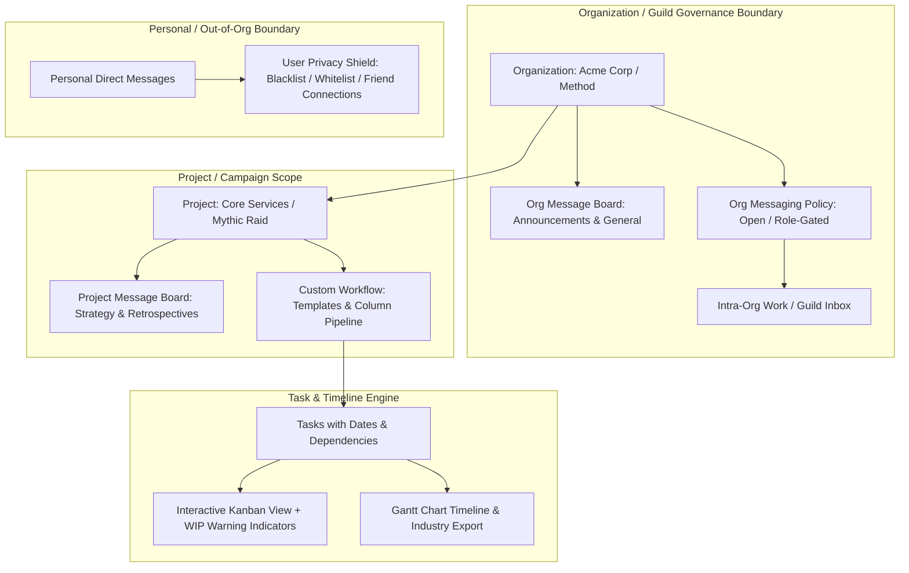
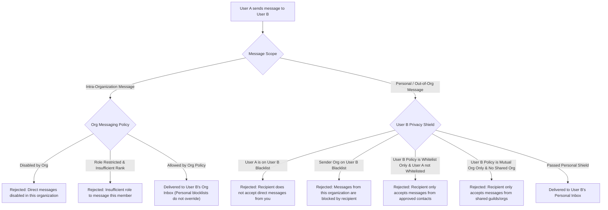
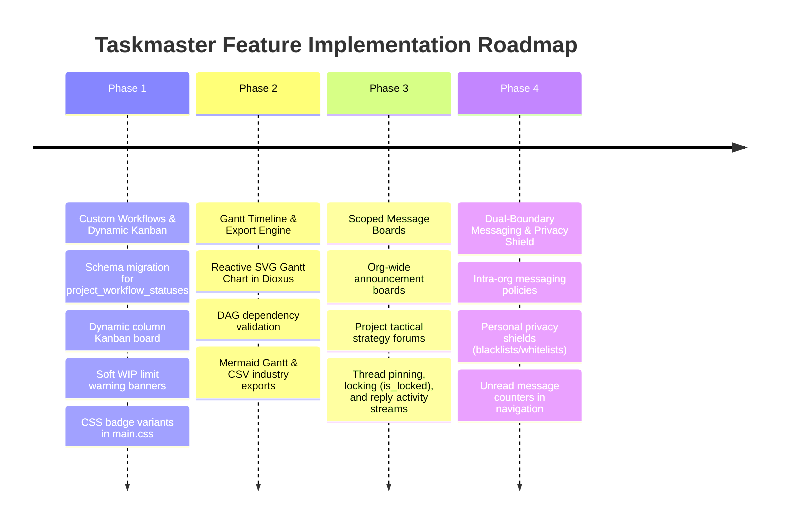

# Taskmaster: Extensibility, Custom Workflows, Message Boards & Messaging Architecture

## Overview & Executive Summary

**Taskmaster** bridges two worlds that are traditionally separated:
1. **Gaming Guilds & Communities** (MMO guilds, raid teams, esports squads, community mod teams): escaping the unorganized chaos of Discord pins and bloated spreadsheets.
2. **Innovative Startups & Agile Teams**: seeking lightweight, responsive, fullstack Rust task management without enterprise bloatware.

This blueprint details three foundational systems to realize this vision:
- **System A: Customizable Project Workflows & Templates (Kanban $\leftrightarrow$ Gantt)**: Configurable project pipelines, semantic CSS badge variants, soft WIP limits, task dependencies, start/due dates, and Gantt visualization.
- **System B: Scoped Message Boards**: Forum-style discussion hubs at both the Organization/Guild level and the Project/Raid level with moderation controls (pinning, locking).
- **System C: Dual-Boundary Messaging**: Strict separation between **Intra-Organization Inboxes** (governed by organization policy; mandatory channels cannot be unilaterally bypassed) and **Personal Inboxes** (user-controlled privacy shields with blacklists and whitelists).
- **System D: High-Level Test Campaigns & Acceptance Criteria**: Rigorous test suites covering backend database logic, API guardrails, and Dioxus 0.7 SSR rendering.

---



---

## 1. Customizable Project-Specific Workflows & Gantt Charts

### Problem Statement
Currently, `TaskStatus` is a fixed 5-state Rust enum (`Suggested`, `Accepted`, `Assigned`, `InProgress`, `Finished`). Different projects have completely different lifecycles:
* **Engineering Sprint**: `Backlog` $\rightarrow$ `Sprint Ready` $\rightarrow$ `In Progress` $\rightarrow$ `In Review` $\rightarrow$ `Done`
* **Guild Consumable / Crafting Prep**: `Bounty Posted` $\rightarrow$ `Farming Mats` $\rightarrow$ `Crafting / Brewed` $\rightarrow$ `Vault Deposited`
* **Raid Tactics & Boss Progression**: `Theorycraft` $\rightarrow$ `Strategy Approved` $\rightarrow$ `Assigned to Role` $\rightarrow$ `Progressing` $\rightarrow$ `Defeated`

### Database Schema

```sql
-- Standard status categories ensure unified metrics, reporting, and Gantt alignment
CREATE TYPE workflow_category AS ENUM ('todo', 'in_progress', 'review', 'done', 'archived');

CREATE TABLE project_workflow_statuses (
    id BIGSERIAL PRIMARY KEY,
    project_id BIGINT NOT NULL REFERENCES projects(id) ON DELETE CASCADE,
    name VARCHAR(60) NOT NULL,
    category workflow_category NOT NULL DEFAULT 'todo',
    -- Colors belong in CSS: Store semantic badge variants mapping to classes in main.css
    -- e.g. 'default', 'info', 'success', 'warning', 'danger', 'purple', 'teal'
    badge_variant VARCHAR(30) NOT NULL DEFAULT 'default',
    position INT NOT NULL DEFAULT 0,
    -- Nullable WIP limit: settable by project leader. Database does NOT block writes;
    -- UI and application logic render visual warnings when the threshold is exceeded.
    wip_limit INT NULL,
    created_at TIMESTAMPTZ NOT NULL DEFAULT NOW()
);

CREATE INDEX idx_project_workflow_statuses_proj ON project_workflow_statuses(project_id, position);

-- Enhance tasks with timeline coordinates and custom workflow status
ALTER TABLE tasks 
    ADD COLUMN workflow_status_id BIGINT REFERENCES project_workflow_statuses(id) ON DELETE SET NULL,
    ADD COLUMN start_date TIMESTAMPTZ,
    ADD COLUMN due_date TIMESTAMPTZ,
    ADD COLUMN estimated_hours INT,
    ADD COLUMN progress_percent INT DEFAULT 0;

-- Task dependency graph for Gantt critical paths
CREATE TABLE task_dependencies (
    id BIGSERIAL PRIMARY KEY,
    project_id BIGINT NOT NULL REFERENCES projects(id) ON DELETE CASCADE,
    predecessor_task_id BIGINT NOT NULL REFERENCES tasks(id) ON DELETE CASCADE,
    successor_task_id BIGINT NOT NULL REFERENCES tasks(id) ON DELETE CASCADE,
    dependency_type VARCHAR(20) NOT NULL DEFAULT 'finish_to_start', -- finish_to_start, start_to_start
    created_at TIMESTAMPTZ NOT NULL DEFAULT NOW(),
    CONSTRAINT unique_dependency_pair UNIQUE(predecessor_task_id, successor_task_id),
    CONSTRAINT no_self_dependency CHECK (predecessor_task_id != successor_task_id)
);
```

### Pre-packaged Workflow Templates
When creating a project, users can pick a starter template:
1. **Classic Kanban**: To Do $\rightarrow$ In Progress $\rightarrow$ In Review $\rightarrow$ Done
2. **Guild Raid Prep**: Requisition $\rightarrow$ Gathering Materials $\rightarrow$ Crafting $\rightarrow$ Staged for Raid
3. **Software Sprint**: Icebox $\rightarrow$ Up Next $\rightarrow$ Developing $\rightarrow$ Testing $\rightarrow$ Shipped
4. **Custom**: Freeform column builder with custom labels and semantic badge variants.

### WIP Limit Behavior: Soft Gates & Visual Warnings
* The `wip_limit` field is nullable (`NULL` = uncapped).
* It is configured per-column by the project leader or admin.
* **Non-blocking**: If a task is moved to a column exceeding its WIP limit, the database does **not** fail the transaction.
* **Visual indicator**: The column header in the Kanban board turns amber/red (e.g. `In Progress (4/3) - WIP Limit Exceeded`), alerting the team to bottlenecking without interrupting immediate operational velocity.

### Gantt Chart Rendering & Export
- **Rendering**: A reactive Dioxus SVG timeline component rendering bars mapped to `start_date` and `due_date`, with dependency connector curves between predecessors and successors.
- **Exporting**:
  - **Mermaid Gantt**: Direct copy-to-clipboard for docs and markdown.
  - **CSV / MS Project / Industry Standard JSON**: Clean tabular export for engineering timelines.

---

## 2. Organization & Project Message Boards

### Architecture
Separate announcement and discussion boards avoid chat noise and keep high-value documentation visible:
- **Organization-Wide Boards**: Announcements, Guild Rules, Roster recruitment, General lounge.
- **Project-Specific Boards**: Boss strategies, Sprint retrospectives, Architecture decision records (ADRs).

```sql
CREATE TABLE message_boards (
    id BIGSERIAL PRIMARY KEY,
    organization_id BIGINT NOT NULL REFERENCES organizations(id) ON DELETE CASCADE,
    project_id BIGINT REFERENCES projects(id) ON DELETE CASCADE, -- NULL indicates Org-wide board
    name VARCHAR(100) NOT NULL,
    description TEXT,
    is_announcements_only BOOLEAN NOT NULL DEFAULT FALSE, -- Only admins/leaders can create topics
    created_at TIMESTAMPTZ NOT NULL DEFAULT NOW()
);

CREATE TABLE board_topics (
    id BIGSERIAL PRIMARY KEY,
    board_id BIGINT NOT NULL REFERENCES message_boards(id) ON DELETE CASCADE,
    author_id BIGINT NOT NULL REFERENCES users(id) ON DELETE CASCADE,
    title VARCHAR(255) NOT NULL,
    content TEXT NOT NULL,
    is_pinned BOOLEAN NOT NULL DEFAULT FALSE,
    -- is_locked: When true, regular members cannot post new replies.
    -- Used by moderators to archive resolved discussions, conclude votes, or lock official announcements.
    -- Only organization admins and moderators can toggle this field or reply to locked topics.
    is_locked BOOLEAN NOT NULL DEFAULT FALSE,
    reply_count INT NOT NULL DEFAULT 0,
    last_activity_at TIMESTAMPTZ NOT NULL DEFAULT NOW(),
    created_at TIMESTAMPTZ NOT NULL DEFAULT NOW(),
    updated_at TIMESTAMPTZ NOT NULL DEFAULT NOW()
);

CREATE TABLE board_replies (
    id BIGSERIAL PRIMARY KEY,
    topic_id BIGINT NOT NULL REFERENCES board_topics(id) ON DELETE CASCADE,
    author_id BIGINT NOT NULL REFERENCES users(id) ON DELETE CASCADE,
    content TEXT NOT NULL,
    created_at TIMESTAMPTZ NOT NULL DEFAULT NOW(),
    updated_at TIMESTAMPTZ NOT NULL DEFAULT NOW()
);

CREATE INDEX idx_board_topics_activity ON board_topics(board_id, is_pinned DESC, last_activity_at DESC);
CREATE INDEX idx_board_replies_topic ON board_replies(topic_id, created_at ASC);
```

### Permission Gates
- **View Access**: Handled through our existing `verify_org_access` and `verify_project_access` helpers.
- **Posting in Announcements**: Checked against `permissions_mask` (`MANAGE_SETTINGS` or `ORG_ADMIN`).
- **Topic Moderation (Pin / Lock)**: Restricted to project leaders or organization officers.

---

## 3. Direct Messaging: Intra-Org vs. Personal Boundary

### Two Distinct Communication Realms
To prevent spam while maintaining corporate and guild accountability, messages are divided into two distinct scopes:

1. **Intra-Organization / Work / Guild Inboxes**:
   - Sent between members within an organization workspace.
   - **Governed by Organization Policy**: The employer or guild master defines messaging policy (`open`, `role_restricted`, `disabled`).
   - **Accountability Invariant**: Personal user blocklists **cannot** unilaterally block intra-organization communications (e.g. an employee cannot block their manager or organization-wide operational alerts).
2. **Personal / Out-of-Organization Direct Messages**:
   - For peer-to-peer communication across guilds, friend networks, or between users with no shared organization.
   - **User Privacy Shield**: The user has complete autonomy over their personal inbox:
     - Policy: `Open`, `Mutual-Guild/Org Only`, or `Friends/Whitelist Only`.
     - Anti-Spam Blacklist: Block specific users or rogue organizations from sending unsolicited personal DMs.
     - Friend Requests / Whitelist: Direct approval required before unknown users can initiate personal chat.



### Database Schema

```sql
-- 1. Org-level messaging policy
CREATE TYPE org_messaging_policy AS ENUM ('open', 'role_restricted', 'disabled');

ALTER TABLE organizations 
    ADD COLUMN messaging_policy org_messaging_policy NOT NULL DEFAULT 'open';

-- 2. User-level privacy settings & list rules for Personal Inboxes
CREATE TYPE user_personal_dm_policy AS ENUM ('allow_all', 'mutual_org_only', 'whitelist_only');

CREATE TABLE user_privacy_settings (
    user_id BIGINT PRIMARY KEY REFERENCES users(id) ON DELETE CASCADE,
    personal_dm_policy user_personal_dm_policy NOT NULL DEFAULT 'mutual_org_only',
    updated_at TIMESTAMPTZ NOT NULL DEFAULT NOW()
);

CREATE TYPE privacy_rule_kind AS ENUM (
    'blacklist_user', 
    'whitelist_user', 
    'blacklist_org', 
    'whitelist_org'
);

CREATE TABLE user_privacy_rules (
    id BIGSERIAL PRIMARY KEY,
    user_id BIGINT NOT NULL REFERENCES users(id) ON DELETE CASCADE,
    rule_kind privacy_rule_kind NOT NULL,
    target_id BIGINT NOT NULL, -- references user_id or organization_id
    note VARCHAR(100),
    created_at TIMESTAMPTZ NOT NULL DEFAULT NOW(),
    CONSTRAINT unique_user_rule UNIQUE(user_id, rule_kind, target_id)
);

-- 3. Conversations (tagged as either org-scoped or personal)
CREATE TABLE direct_conversations (
    id BIGSERIAL PRIMARY KEY,
    user_a_id BIGINT NOT NULL REFERENCES users(id) ON DELETE CASCADE,
    user_b_id BIGINT NOT NULL REFERENCES users(id) ON DELETE CASCADE,
    organization_id BIGINT REFERENCES organizations(id) ON DELETE CASCADE, -- NULL = Personal conversation
    created_at TIMESTAMPTZ NOT NULL DEFAULT NOW(),
    last_message_at TIMESTAMPTZ NOT NULL DEFAULT NOW()
);

CREATE UNIQUE INDEX unique_personal_pair 
    ON direct_conversations(LEAST(user_a_id, user_b_id), GREATEST(user_a_id, user_b_id)) 
    WHERE organization_id IS NULL;

CREATE UNIQUE INDEX unique_org_pair 
    ON direct_conversations(organization_id, LEAST(user_a_id, user_b_id), GREATEST(user_a_id, user_b_id)) 
    WHERE organization_id IS NOT NULL;

CREATE TABLE direct_messages (
    id BIGSERIAL PRIMARY KEY,
    conversation_id BIGINT NOT NULL REFERENCES direct_conversations(id) ON DELETE CASCADE,
    sender_id BIGINT NOT NULL REFERENCES users(id) ON DELETE CASCADE,
    recipient_id BIGINT NOT NULL REFERENCES users(id) ON DELETE CASCADE,
    content TEXT NOT NULL,
    read_at TIMESTAMPTZ,
    created_at TIMESTAMPTZ NOT NULL DEFAULT NOW()
);

CREATE INDEX idx_dm_conv ON direct_messages(conversation_id, created_at DESC);
CREATE INDEX idx_user_privacy_lookup ON user_privacy_rules(user_id, rule_kind, target_id);
```

---

## 4. High-Level Test Campaigns & Acceptance Criteria

To ensure reliable, enterprise-ready software and race-condition-free concurrency, we define 5 structured test campaigns.

### Campaign 1: Dynamic Workflow Pipeline & Soft WIP Limits
* **Goal**: Validate that project workflow statuses can be created, ordered, templated, and that soft WIP limits alert without crashing writes.
* **Acceptance Criteria**:
  1. **Template Instantiation**: Creating a project with the "Classic Kanban" template generates 4 ordered statuses (`To Do`, `In Progress`, `In Review`, `Done`).
  2. **Custom Status Lifecycle**: Project leaders can add, rename, and delete custom columns.
  3. **Orphan Task Safety**: Deleting a column with active tasks requires specifying a target fallback status or reassigns tasks gracefully to the default category status.
  4. **Soft WIP Limit Enforcement**: Moving a 4th task into a column with `wip_limit = 3` succeeds in the database, but server/UI state returns `is_wip_exceeded: true` and the Kanban column renders warning classes.
  5. **Category Grouping**: Tasks in custom columns correctly reflect their underlying `workflow_category` (`todo`, `in_progress`, `done`) across dashboard aggregations.

### Campaign 2: Task Dependencies & Gantt Chart Timeline
* **Goal**: Validate directed acyclic graph (DAG) task dependency integrity and Gantt data exports.
* **Acceptance Criteria**:
  1. **Acyclic Validation**: Attempting to add a cyclic dependency ($Task\ A \rightarrow Task\ B \rightarrow Task\ A$) fails with HTTP 400 (`Circular dependency detected`).
  2. **Self-Dependency Rejection**: Setting $Task\ A \rightarrow Task\ A$ is rejected by database constraint and application preflight.
  3. **Timeline Ranges**: Validates that `due_date >= start_date`. Tasks with missing dates default cleanly to 1-day spans on the timeline.
  4. **Mermaid Export Format**: Validates that calling the export endpoint returns well-formed Mermaid markup:
     ```mermaid
     gantt
       title Project Schedule
       dateFormat YYYY-MM-DD
       section Core
       Task 1 :a1, 2026-10-01, 5d
       Task 2 :after a1, 3d
     ```
  5. **CSV Export Integrity**: The CSV export includes Task ID, Title, Status, Predecessors, Start Date, Due Date, and Estimated Hours.

### Campaign 3: Scoped Message Boards & Moderation Controls
* **Goal**: Validate organizational announcement role-gates, topic lifecycle, and thread locking.
* **Acceptance Criteria**:
  1. **Announcement Role-Gating**: Non-officers/members attempting to create a topic in `is_announcements_only = true` boards receive HTTP 403 Forbidden.
  2. **Project Board Scope Isolation**: Users who are members of Project A cannot view or post to Project B's message board unless they are explicitly members of Project B.
  3. **Thread Pinning**: Pinned topics consistently sort at the top of board index queries regardless of `last_activity_at`.
  4. **Thread Locking (`is_locked`)**: When an admin locks a topic (`is_locked = true`), subsequent reply attempts by standard members fail with HTTP 403 (`Topic is locked for replies`). Admins retain the ability to reply or unlock.

### Campaign 4: Intra-Org vs. Personal Messaging Governance
* **Goal**: Verify strict separation between organization-controlled inboxes and user-controlled personal shields.
* **Acceptance Criteria**:
  1. **Intra-Org Role Policy**: When an organization sets `messaging_policy = 'role_restricted'`, viewers cannot initiate DMs to members without clearance; admins can message all members.
  2. **Personal Blacklist Filtering**: When User B adds User A to their personal `blacklist_user` list, User A's out-of-org direct message attempt fails with HTTP 403.
  3. **Non-Override Invariant**: User B's personal blacklist of User A **does not** block User A from messaging User B within the context of Organization X, provided Organization X's policy permits it.
  4. **Whitelist Shield**: When User B sets `personal_dm_policy = 'whitelist_only'`, any sender not explicitly on User B's `whitelist_user` list is blocked.
  5. **Org Blacklist**: When User B blacklists Organization Y, no out-of-org personal messages from members citing Organization Y are delivered.

### Campaign 5: Dioxus SSR Component Verification
* **Goal**: Guarantee server-side rendering performance, tag safety, and unauthenticated page isolation.
* **Acceptance Criteria**:
  1. **Kanban SSR**: Dynamic columns and WIP limit warnings render into pure HTML strings in $< 5\text{ms}$.
  2. **Message Board SSR**: Topic lists, badge variants, and locked icons render valid semantic HTML.
  3. **Auth Boundary SSR**: Unauthenticated SSR requests to board or chat routes redirect to `/login`.
  4. **Test Independence**: All SSR tests execute in-memory via `VirtualDom` without touching PostgreSQL.

---

## 5. Phased Implementation Roadmap



### Phase 1: Project Workflows & Dynamic Kanban
- [ ] Add `project_workflow_statuses` with nullable `wip_limit` and `badge_variant`.
- [ ] Define semantic badge CSS classes in [`assets/main.css`](file:///home/eikj/repos/tutorials/webdev/todolist/assets/main.css).
- [ ] Implement Starter Templates (Classic Kanban, Guild Raid Prep, Software Sprint).
- [ ] Update Kanban board (`board.rs`) to fetch dynamic columns with soft WIP warning indicators.
- [ ] Write integration and SSR tests for dynamic column rendering.

### Phase 2: Gantt Chart View & Exports
- [ ] Add `start_date`, `due_date`, and `task_dependencies` table with acyclic graph checks.
- [ ] Build interactive Dioxus SVG Gantt component toggleable on the Kanban page.
- [ ] Provide one-click export to Mermaid Gantt markup and standard CSV/JSON.
- [ ] Implement Campaign 2 dependency and export tests.

### Phase 3: Scoped Message Boards
- [ ] Create `message_boards`, `board_topics`, and `board_replies`.
- [ ] Mount "Message Board" tabs on Organization and Project pages.
- [ ] Implement topic pinning and topic locking (`is_locked`) moderation.
- [ ] Implement Campaign 3 board access and moderation tests.

### Phase 4: Dual-Boundary Messaging & Privacy Controls
- [ ] Build `direct_conversations` and `direct_messages` separated by scope (`organization_id` vs Personal).
- [ ] Add `user_privacy_rules` (blacklists, whitelists) and `user_privacy_settings`.
- [ ] Implement org-level messaging policies (`open`, `role_restricted`, `disabled`).
- [ ] Enforce the non-override invariant (personal shields cannot block mandatory intra-org communication).
- [ ] Implement Campaign 4 dual-boundary verification tests.
